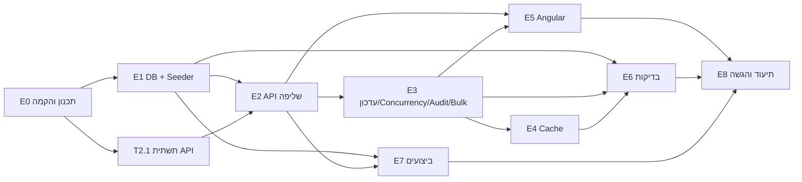

# PLAN – מערכת לניהול פניות (מבדק Full Stack)

> המסמך מתרגם את דרישות המבדק לתוכנית עבודה: החלטות, ארכיטקטורה, חוזה API, משימות עם תלויות והערכות מאמץ, וטבלת קישור בין כל דרישה למשימות שמכסות אותה.
> הוא נשמר ב־repo ומתעדכן במהלך הפיתוח. בסוף כל משימה הסטטוס בטבלה מתעדכן.

---

## 1. החלטות שנסגרו

| נושא | החלטה | נימוק בקצרה |
|---|---|---|
| בסיס נתונים | **SQL Server 2022** (בקונטיינר) | `rowversion` מובנה ל־Optimistic Concurrency, Execution Plan ו־`STATISTICS IO/TIME` למדידה, אינטגרציה טבעית עם EF Core |
| Backend | **.NET 10 (LTS) + ASP.NET Core Web API (Controllers) + EF Core 10** | גרסת LTS עדכנית. Controllers מוכרים לבודקים ומסודרים לחוזה REST |
| Frontend | **Angular** (גרסה יציבה עדכנית, Standalone Components) + **Angular Material** | טבלה, Paginator ו־Dialog מוכנים, בלי השקעה בעיצוב (המבדק מבקש לא להשקיע בעיצוב) |
| Bulk | **Partial Success** | כמה משתמשים עובדים במקביל, ולכן התנגשות בפנייה אחת לא תחסום 99 עדכונים תקינים. כל פנייה מקבלת תוצאה מפורטת |
| הרצה והגשה | **GitHub (ציבורי) + Docker Compose** | `docker compose up` מרים DB, API ו־Web. אין הגשת ZIP |
| חלוקת עבודה | Claude כותב ומריץ, המפתחת בודקת, מריצה ומאשרת כל שלב | |

### החלטות שאני מציע כברירת מחדל (לאישור)
1. **מעברי סטטוס מותרים** (מכונת מצבים):

   | מ־ \ אל | New | InProgress | Waiting | Completed |
   |---|---|---|---|---|
   | **New** | – | ✔ | ✔ | ✖ |
   | **InProgress** | ✖ | – | ✔ | ✔ |
   | **Waiting** | ✖ | ✔ | – | ✔ |
   | **Completed** | ✖ | ✔ (פתיחה מחדש) | ✖ | – |

   מעבר לאותו סטטוס נחשב מעבר לא חוקי.
2. **ChangedBy בלי מערכת הזדהות:** הלקוח שולח כותרת `X-User-Name`, וב־UI בוחרים "משתמש נוכחי" מתוך רשימה. ההזדהות חסרה בכוונה ותתועד כ"מגבלה ידועה".
3. **חיפוש טקסטואלי:** `LIKE '%term%'` על `Title` ו־`OrganizationName`, תמיד בשילוב עם שאר הסינונים, עם מדידה. Full-Text Search מתועד כחלופה וכשיפור עתידי (ראו סעיף 7).
4. **דפדוף:** Offset (`page`/`pageSize`) עם `pageSize` מקסימלי 100. Keyset Pagination מתועד כשיפור לדפים עמוקים.

---

## 2. מבנה הפתרון

```
/
├─ README.md                  ← הוראות הרצה ותיעוד הפתרון (דרישה 11)
├─ PLAN.md                    ← המסמך הזה (דרישה 9)
├─ docs/
│  ├─ performance.md          ← מדידות, Execution Plans, אינדקסים (דרישה 6)
│  └─ decisions.md            ← החלטות טכנולוגיות וחלופות
├─ docker-compose.yml         ← sqlserver + api + web + seeder
├─ .github/workflows/ci.yml   ← Build + Tests בכל Push
├─ backend/
│  ├─ RequestsManagement.sln
│  ├─ src/
│  │  ├─ RequestsManagement.Domain/          ← ישויות, Enums, כללי מעבר סטטוס (ללא תלויות)
│  │  ├─ RequestsManagement.Infrastructure/  ← DbContext, Configurations, Migrations
│  │  └─ RequestsManagement.Api/             ← Controllers, Features/Requests (Services, DTOs, Validators, Mapping), Middleware
│  ├─ tools/RequestsManagement.Seeder/       ← יצירה חוזרת של 100,000 רשומות
│  └─ tests/
│     ├─ RequestsManagement.UnitTests/
│     └─ RequestsManagement.IntegrationTests/
└─ frontend/requests-web/                    ← Angular
```

**נמנעים בכוונה מ־Over-Engineering:**
- אין Repository Pattern מעל EF Core, כי `DbContext` כבר מממש Unit of Work ו־Repository.
- אין CQRS, MediatR או Microservices.
- שלוש שכבות בלבד: Domain, Infrastructure ו־Api.

---

## 3. מודל נתונים ואינדקסים

### טבלה `Requests`
| עמודה | טיפוס | הערות |
|---|---|---|
| Id | `int IDENTITY` PK (Clustered) | |
| Title | `nvarchar(200)` NOT NULL | |
| OrganizationName | `nvarchar(200)` NOT NULL | |
| Status | `tinyint` NOT NULL | Enum: New=0, InProgress=1, Waiting=2, Completed=3 |
| Priority | `tinyint` NOT NULL | Enum: Low=0, Medium=1, High=2 |
| AssignedTo | `nvarchar(100)` NULL | פנייה חדשה יכולה להיות לא משויכת |
| CreatedAt | `datetime2(3)` NOT NULL | UTC |
| UpdatedAt | `datetime2(3)` NOT NULL | UTC, מתעדכן בכל שינוי |
| RowVersion | `rowversion` | מתעדכן אוטומטית ב־DB, משמש Concurrency Token |

### טבלה `RequestStatusHistory`
| עמודה | טיפוס |
|---|---|
| Id | `bigint IDENTITY` PK |
| RequestId | `int` FK → Requests |
| PreviousStatus | `tinyint` |
| NewStatus | `tinyint` |
| ChangedAt | `datetime2(3)` UTC |
| ChangedBy | `nvarchar(100)` |

### אינדקסים מתוכננים (יאומתו במדידה ב־T7.1)
| אינדקס | עמודות | תרחיש שהוא משרת |
|---|---|---|
| `IX_Requests_Status_CreatedAt` | (Status, CreatedAt DESC) INCLUDE (Priority, AssignedTo, Title, OrganizationName, UpdatedAt) | המסך הראשי: סינון לפי סטטוס עם מיון ברירת מחדל לפי תאריך יצירה, ו־Aggregation לפי סטטוס |
| `IX_Requests_AssignedTo_Status` | (AssignedTo, Status) | "הפניות של מטפל X" |
| `IX_Requests_OrganizationName` | (OrganizationName) | סינון שוויון לפי ארגון, ו־Lookup של רשימת הארגונים |
| `IX_Requests_CreatedAt` | (CreatedAt) | טווח תאריכים בלי סינון סטטוס |
| `IX_Requests_Priority_Status` | (Priority, Status) | Aggregation לפי עדיפות, וסינון לפי עדיפות |
| `IX_History_RequestId_ChangedAt` | (RequestId, ChangedAt DESC) | היסטוריית פנייה |

אינדקסים שלא יוכיחו תועלת במדידה יוסרו. המטרה היא סט מינימלי ומנומק, לא אינדקס לכל עמודה.

### Seeder (נתוני בדיקה)
- 100,000 פניות. כ־500 ארגונים, כ־30 מטפלים, תאריכים מפוזרים על פני שנתיים, והתפלגות סטטוסים ועדיפויות לא אחידה (מציאותית).
- **דטרמיניסטי** (`Random` עם Seed קבוע), כך שכל הרצה מייצרת אותם נתונים ואפשר להשוות מדידות.
- **יצירה חוזרת:** הפקודה מנקה את הטבלאות (`TRUNCATE`/`DELETE`) ומייצרת מחדש. כתיבה ב־`SqlBulkCopy` לוקחת שניות ולא דקות.
- הרצה: `docker compose run --rm seeder`, או `dotnet run --project tools/RequestsManagement.Seeder -- --count 100000`.

---

## 4. חוזה ה־API

כל השגיאות מוחזרות כ־**ProblemDetails** (RFC 9457), כולל `traceId`.

| Method | Route | תיאור | תגובות |
|---|---|---|---|
| GET | `/api/requests` | רשימה עם סינון, חיפוש, מיון ודפדוף | 200 `PagedResult<RequestListItemDto>`, 400 |
| GET | `/api/requests/{id}` | פנייה בודדת | 200, 404 |
| GET | `/api/requests/summary` | Aggregations (מקבל את אותם פרמטרי סינון) | 200, 400 |
| PATCH | `/api/requests/{id}/status` | עדכון סטטוס | 200 `RequestDto` (עם RowVersion חדש), 400, 404, 409, 422 |
| GET | `/api/requests/{id}/history` | היסטוריית שינויים | 200, 404 |
| POST | `/api/requests/bulk/status` | עדכון של עד 100 פניות | 200 `BulkStatusUpdateResult`, 400 |
| GET | `/api/lookups` | רשימות מטפלים, ארגונים וסטטוסים לטופסי הסינון | 200 |

### פרמטרים של `GET /api/requests`
`page` (ברירת מחדל 1, מינימום 1) · `pageSize` (ברירת מחדל 25, טווח 1–100) · `status` (רשימה, למשל `status=New&status=Waiting`) · `priority` (רשימה) · `organizationName` · `assignedTo` · `createdFrom` / `createdTo` (ובתנאי `createdFrom <= createdTo`) · `search` (עד 100 תווים) · `sortBy` ∈ {`createdAt`, `updatedAt`, `priority`, `status`, `title`} · `sortDir` ∈ {`asc`, `desc`}

- מיון יציב: תמיד מתווסף `Id` כ־Tie-breaker, כדי שדפים לא "יקפצו".
- `sortBy` עובר Whitelist ולא נבנה כטקסט חופשי, כך שאין חשש ל־SQL Injection.

### תשובת `summary` (שתי Aggregations לפחות)
```json
{ "total": 100000,
  "byStatus":   [{ "status": "New", "count": 24890 }, ...],
  "byPriority": [{ "priority": "High", "count": 20112 }, ...] }
```

### עדכון סטטוס
```json
PATCH /api/requests/42/status
X-User-Name: dana
{ "newStatus": "InProgress", "rowVersion": "AAAAAAAAB9E=" }
```
| מצב | קוד |
|---|---|
| הפנייה לא קיימת | **404** |
| ערך סטטוס לא קיים, rowVersion חסר, או אין X-User-Name | **400** (ValidationProblemDetails) |
| מעבר אסור לפי מכונת המצבים | **422** עם הודעה ברורה ("לא ניתן לעבור מ־Completed ל־Waiting") |
| rowVersion לא תואם (עדכון מתחרה) | **409** עם הנתונים העדכניים של הפנייה, כדי שה־UI יוכל להציג אותם |

### Bulk (Partial Success)
```json
POST /api/requests/bulk/status
{ "newStatus": "Completed",
  "items": [ { "id": 1, "rowVersion": "..." }, { "id": 2, "rowVersion": "..." } ] }
→ 200
{ "requested": 2, "succeeded": 1, "failed": 1,
  "results": [ { "id": 1, "outcome": "Updated", "rowVersion": "..." },
               { "id": 2, "outcome": "Conflict", "message": "..." } ] }
```
- `outcome` ∈ {`Updated`, `NotFound`, `Conflict`, `InvalidTransition`}.
- תשובת **400** על הבקשה כולה: יותר מ־100 פריטים, רשימה ריקה, או מזהים כפולים.
- מימוש: טוענים את כל הפניות בשאילתה אחת. כל פריט נשמר בנפרד יחד עם רשומת ה־Audit שלו, בטרנזקציה קטנה משלו. כך כישלון של פריט אחד לא מבטל את האחרים.
- התשובה היא 200 גם כשחלק מהפריטים נכשלו, כי הבקשה עובדה בהצלחה והתוצאה לכל פריט מופיעה בגוף התשובה. 207 Multi-Status הוא חלופה שתתועד.

---

## 5. Concurrency ו־Audit: איך זה נאכף בשרת וב־DB
1. הלקוח שולח את ה־`rowVersion` שקיבל בשליפה.
2. השרת טוען את הפנייה (או מחזיר 404) ובודק את חוקיות המעבר (או מחזיר 422).
3. ה־`OriginalValue` של `RowVersion` מוגדר לערך שהלקוח שלח. EF Core מייצר `UPDATE ... WHERE Id=@id AND RowVersion=@original`.
4. באותה טרנזקציה מתעדכן `UpdatedAt` ונוספת שורה ל־`RequestStatusHistory`.
5. אם אף שורה לא עודכנה, נזרק `DbUpdateConcurrencyException` והשרת מחזיר **409**. ה־Audit לא נשמר, כי זו אותה טרנזקציה.
6. ה־`rowversion` מתעדכן אוטומטית ב־DB, כך שאין Lost Update גם אם שני עדכונים מגיעים באותה מילישנייה.

---

## 6. Cache
- **מה נשמר:** תוצאת `summary` **ללא סינון** (תמונת המצב הכללית שמוצגת בכל טעינת מסך). זו שאילתת Aggregation על 100 אלף רשומות שנקראת הרבה ומשתנה רק כשמתבצע עדכון סטטוס. Summary עם סינון לא נשמר, כי מספר הצירופים גדול וההסתברות לפגיעה ב־Cache נמוכה.
- **Expiration:** `AbsoluteExpiration` של 60 שניות, כרשת ביטחון.
- **Invalidation:** כל עדכון סטטוס מוצלח, בודד או Bulk, מסיר את המפתח מה־Cache.
- **מימוש:** `IMemoryCache` מאחורי ממשק `ISummaryCache`.
- **הרחבה למספר מופעי שרת:** החלפת המימוש ל־`IDistributedCache` (Redis). המופע שמעדכן מוחק את המפתח המשותף, ואם יש גם Cache מקומי, נשלחת הודעת Invalidation ב־Redis Pub/Sub. אפשר גם להשתמש ב־HybridCache של .NET עם Tags. החלופה תתועד ולא תמומש, כדי לא להוסיף מורכבות שאין בה צורך.

---

## 7. ביצועים: מה נמדד
נמדדות שתי פעולות מרכזיות על 100 אלף הרשומות, **לפני ואחרי** הוספת האינדקסים:
1. `GET /api/requests` עם סינון סטטוס, טווח תאריכים, מיון לפי CreatedAt DESC ודף 1 וגם דף עמוק.
2. `GET /api/requests/summary` (Aggregations).

שלוש דרכי מדידה:
- `SET STATISTICS IO, TIME ON`: מספר Logical Reads וזמן CPU.
- Actual Execution Plan: Seek מול Scan, ו־Key Lookups.
- זמני תגובה של ה־API (Stopwatch בלוג או כלי פשוט כמו `bombardier`/`k6`, אם זמין).

**Bottlenecks צפויים, שאת קיומם יש לאמת:**
- `LIKE '%x%'` לא יכול להשתמש ב־Seek. **שיפור:** Full-Text Index, או חיפוש בתחילת מילה (`LIKE 'x%'`).
- `COUNT(*)` על סינון רחב. **שיפור:** Cache או ספירה משוערת.
- Offset עמוק. **שיפור:** Keyset Pagination.

**אין טעינה לזיכרון:** כל הסינון, המיון והדפדוף מתבצעים ב־`IQueryable`, ומתורגמים ל־SQL אחד עם `OFFSET/FETCH`. השליפה מתבצעת עם `AsNoTracking` ו־Projection ישיר ל־DTO (`Select`), כך שנשלפות רק העמודות הנדרשות.

---

## 8. Angular: ארכיטקטורה
| יחידה | אחריות |
|---|---|
| `RequestsApiService` | קריאות HTTP בלבד, בלי State |
| `RequestsListStore` (Service) | State של הרשימה: `filters$` → `debounceTime(300)` לחיפוש → `distinctUntilChanged` → `switchMap` (מבטל בקשה קודמת) → `{ loading, error, data }` |
| `SummaryStore` | טעינת ה־Aggregations ורענון אחרי עדכון |
| `RequestsPageComponent` (Container) | מחבר בין ה־Stores לרכיבי התצוגה |
| `RequestsFiltersComponent` | טופס סינון וחיפוש (Presentational) |
| `RequestsTableComponent` | טבלה, מיון, דפדוף ובחירה מרובה (Presentational) |
| `SummaryPanelComponent` | הצגת ה־Aggregations |
| `StatusChangeDialogComponent` | עדכון סטטוס: מציג רק מעברים מותרים, וב־**409** מציג "הפנייה עודכנה על ידי משתמש אחר" עם הנתונים העדכניים ואפשרות לרענן |
| `HistoryDialogComponent` | היסטוריית שינויים |
| `BulkActionsBarComponent` | פעולת Bulk והצגת תוצאה לכל פנייה |
| `HttpInterceptor` | הוספת `X-User-Name` וטיפול כללי בשגיאות רשת |

מצבי UI: **Loading** (Spinner, והטבלה הקודמת נשארת מעומעמת), **Empty** ("לא נמצאו פניות התואמות לסינון"), ו־**Error** (הודעה עם כפתור "נסה שוב").

---

## 9. תוכנית עבודה: משימות, תלויות והערכת מאמץ

ההערכות הן בשעות עבודה של מפתח/ת. סטטוס: ⬜ לא התחיל · 🔄 בעבודה · ✅ הושלם.

### E0 – תכנון והקמה
| ID | משימה | מה נדרש | תוצר | תלוי ב־ | מאמץ | דרישה | סטטוס |
|---|---|---|---|---|---|---|---|
| T0.1 | ניתוח אפיון ותוכנית עבודה | פירוק הדרישות, החלטות ושאלות פתוחות | `PLAN.md` | – | 2h | 9 | 🔄 |
| T0.2 | רישום החלטות טכנולוגיות | DB, Bulk, חיפוש, דפדוף, Cache, כולל חלופות | `docs/decisions.md` | T0.1 | 1h | 11 | ⬜ |
| T0.3 | הקמת Repo ו־Solution | מבנה תיקיות, `.editorconfig`, `.gitignore`, `Directory.Build.props` | Solution שעובר Build | T0.1 | 1.5h | 10 | ⬜ |
| T0.4 | שלד Docker ו־CI | `docker-compose` עם SQL Server, ו־GitHub Actions ל־Build ו־Test | Pipeline ירוק | T0.3 | 2h | הגשה | ⬜ |
| T0.5 | סביבת הרצה מקומית ב־Windows | סקריפט התקנה (WSL 2, Git, Docker Desktop, .NET 10 SDK, Node LTS), סקריפט אימות, ומדריך התקנה והרצה בעברית | `scripts/setup-windows.ps1`, `scripts/verify-windows.ps1`, `docs/INSTALL.he.md`, ומחשב המפתחת מוכן להרצה | T0.1 | 1.5h | 11, הגשה | 🔄 |

### E1 – בסיס נתונים ונתוני בדיקה
| ID | משימה | מה נדרש | תוצר | תלוי ב־ | מאמץ | דרישה | סטטוס |
|---|---|---|---|---|---|---|---|
| T1.1 | תכנון מודל ואינדקסים | טבלאות, טיפוסים, אינדקסים מנומקים | סעיף 3 במסמך, ERD | T0.1 | 1.5h | מבנה פנייה, 6 | ✅ (טיוטה) |
| T1.2 | Entities, DbContext ו־Migration | Configurations, `rowversion`, Enums כ־tinyint, אינדקסים | Migration ראשון שרץ | T0.3, T1.1 | 2h | מבנה פנייה, 2 | ⬜ |
| T1.3 | Seeder של 100 אלף רשומות | דטרמיניסטי, `SqlBulkCopy`, ניתן להרצה חוזרת | פקודת Seed שמסיימת בשניות | T1.2 | 3h | יצירת נתונים | ⬜ |

### E2 – API שליפה
| ID | משימה | מה נדרש | תוצר | תלוי ב־ | מאמץ | דרישה | סטטוס |
|---|---|---|---|---|---|---|---|
| T2.1 | תשתית API | DI ו־Lifetimes, `AddProblemDetails` ו־`IExceptionHandler`, Logging, OpenAPI/Swagger, CORS | API עולה, שגיאות כ־ProblemDetails | T0.3 | 2.5h | 10 | ⬜ |
| T2.2 | DTOs, Mapping ו־Validation | מודל Query, ולידטורים (FluentValidation), Mapping ידני ומרוכז | Validation עקבי ו־400 ברור | T2.1, T1.2 | 2h | 1, 10 | ⬜ |
| T2.3 | שירות שליפה | סינון משולב, חיפוש, מיון Whitelist, דפדוף, `AsNoTracking`, Projection, `CancellationToken` | `GET /api/requests` | T2.2 | 3h | 1 | ⬜ |
| T2.4 | פנייה בודדת ו־Lookups | `GET /{id}` עם 404, ו־`GET /api/lookups` | שני Endpoints | T2.3 | 1h | 1, 2 | ⬜ |
| T2.5 | Aggregations | ספירה לפי סטטוס ולפי עדיפות, עם אותם סינונים | `GET /summary` | T2.3 | 1.5h | 1 | ⬜ |

### E3 – עדכון, Concurrency ו־Audit
| ID | משימה | מה נדרש | תוצר | תלוי ב־ | מאמץ | דרישה | סטטוס |
|---|---|---|---|---|---|---|---|
| T3.1 | כללי מעבר סטטוס | מכונת מצבים ב־Domain | `StatusTransitions` עם בדיקות | T1.2 | 1h | 2 | ⬜ |
| T3.2 | עדכון סטטוס | 404/400/422/409, RowVersion, `UpdatedAt`, Audit באותה טרנזקציה, Logging | `PATCH /{id}/status` | T3.1, T2.1 | 3h | 2, 3 | ⬜ |
| T3.3 | היסטוריית שינויים | שליפה ממוינת לפי תאריך | `GET /{id}/history` | T3.2 | 1h | 3 | ⬜ |
| T3.4 | Bulk (Partial Success) | ולידציה (עד 100, ללא כפילויות), טעינה בשאילתה אחת, שמירה לכל פריט, תוצאה מפורטת | `POST /bulk/status` | T3.2 | 3h | 4 | ⬜ |

### E4 – Cache
| ID | משימה | מה נדרש | תוצר | תלוי ב־ | מאמץ | דרישה | סטטוס |
|---|---|---|---|---|---|---|---|
| T4.1 | Cache ל־Summary | `ISummaryCache`, Expiration של 60 שניות, Invalidation בעדכון בודד וב־Bulk | Summary מהיר ותמיד עדכני | T2.5, T3.2, T3.4 | 1.5h | 7 | ⬜ |

### E5 – Angular
| ID | משימה | מה נדרש | תוצר | תלוי ב־ | מאמץ | דרישה | סטטוס |
|---|---|---|---|---|---|---|---|
| T5.1 | הקמת פרויקט | Angular, Material, Proxy ל־API, Models, `RequestsApiService`, Interceptor | אפליקציה שמתחברת ל־API | T2.3 | 2h | 5 | ⬜ |
| T5.2 | Store לרשימה | Debounce, `switchMap`, ומצבי Loading/Empty/Error | `RequestsListStore` | T5.1 | 3h | 5 | ⬜ |
| T5.3 | טבלה, סינון, מיון ודפדוף | רכיבי תצוגה, כשהכול מתבצע בצד השרת | מסך ראשי | T5.2 | 3h | 5 | ⬜ |
| T5.4 | פאנל Aggregations | הצגה ורענון אחרי עדכון | `SummaryPanel` | T5.1, T2.5 | 1h | 5 | ⬜ |
| T5.5 | עדכון סטטוס וטיפול ב־409 | Dialog עם מעברים מותרים והודעת Conflict | עדכון מה־UI | T5.3, T3.2 | 2h | 5 | ⬜ |
| T5.6 | צפייה בהיסטוריה | Dialog | היסטוריה מה־UI | T5.3, T3.3 | 1h | 5 | ⬜ |
| T5.7 | Bulk ב־UI | בחירה מרובה, ביצוע, הצגת תוצאה לכל פנייה | Bulk מה־UI | T5.3, T3.4 | 2h | 4, 5 | ⬜ |

### E6 – בדיקות אוטומטיות
| ID | משימה | מה נדרש | תוצר | תלוי ב־ | מאמץ | דרישה | סטטוס |
|---|---|---|---|---|---|---|---|
| T6.1 | Unit Tests | מעברי סטטוס, ולידציה של Query ושל Bulk | xUnit | T3.1, T2.2 | 1.5h | 8 | ⬜ |
| T6.2 | תשתית Integration | `WebApplicationFactory` עם **Testcontainers** (SQL Server אמיתי) | Fixture משותף | T1.2, T2.1 | 2h | 8 | ⬜ |
| T6.3 | Integration Tests | (1) סינון ודפדוף תקינים (2) 404 (3) **Concurrency: שני עדכונים עם אותו RowVersion, אחד מקבל 200 והשני 409, ונשמרת שורת היסטוריה אחת** (4) Bulk חלקי (5) Invalidation של Cache | בדיקות ירוקות ב־CI | T6.2, T3.4, T4.1 | 3h | 8 | ⬜ |
| T6.4 | בדיקת Store באנגולר (רשות) | `debounce` ו־`switchMap` עם `fakeAsync` | בדיקה אחת | T5.2 | 1h | 8 | ⬜ |

### E7 – ביצועים
| ID | משימה | מה נדרש | תוצר | תלוי ב־ | מאמץ | דרישה | סטטוס |
|---|---|---|---|---|---|---|---|
| T7.1 | מדידה לפני ואחרי אינדקסים | STATISTICS IO/TIME ו־Execution Plans לשתי פעולות | טבלת תוצאות וצילומי Plan | T1.3, T2.3, T2.5 | 3h | 6 | ⬜ |
| T7.2 | Bottleneck והצעת שיפור | ניתוח והמלצה | סעיף ב־`performance.md` | T7.1 | 1h | 6 | ⬜ |

### E8 – תיעוד והגשה
| ID | משימה | מה נדרש | תוצר | תלוי ב־ | מאמץ | דרישה | סטטוס |
|---|---|---|---|---|---|---|---|
| T8.1 | README | הרצה, גרסאות, מבנה, DB ואינדקסים, Concurrency ו־Bulk, Cache, 2 החלטות וחלופות, מגבלה ושיפור, שימוש ב־AI | `README.md` | הכול | 3h | 11 | ⬜ |
| T8.2 | Docker Compose מלא | API, Web (nginx) ו־Seeder, ובדיקה על מכונה נקייה | `docker compose up` עובד | T0.4, T5.7 | 2h | הגשה | ⬜ |
| T8.3 | ביקורת סופית מול מחוון הציון | מעבר על כל סעיף בטבלת ההערכה | Checklist ירוק | T8.1, T8.2 | 1h | הכול | ⬜ |

**סה"כ הערכה:** כ־64.5 שעות עבודה (E0: 8 · E1: 6.5 · E2: 10 · E3: 8 · E4: 1.5 · E5: 14 · E6: 7.5 · E7: 4 · E8: 6).

### סדר ביצוע ותלויות


**שלבי ביצוע (כל שלב מסתיים ב־Commit ובבדיקה שלך):**
1. **שלב א' – יסודות:** T0.5 (במקביל: הכנת המחשב שלך) · T0.2 ← T0.3 ← T0.4 ← T1.2 ← T1.3. אחרי השלב: DB עם 100 אלף רשומות ו־CI ירוק.
2. **שלב ב' – Backend מלא:** T2.1 עד T2.5, אחריהן T3.1 עד T3.4, ואחריהן T4.1. במקביל: T6.1 ו־T6.2, ובדיקות T6.3 נכתבות ביחד עם הפיצ'רים.
3. **שלב ג' – מדידת ביצועים:** T7.1 ו־T7.2. השלב בא מוקדם בכוונה, כדי שאם המדידה תדרוש שינוי אינדקסים, הוא ייעשה לפני ה־UI.
4. **שלב ד' – Angular:** T5.1 עד T5.7.
5. **שלב ה' – הגשה:** T8.2, T8.1, T8.3.

---

## 10. קישור בין דרישות המבדק למשימות
| # | דרישה | משימות |
|---|---|---|
| – | מבנה פנייה ו־100 אלף רשומות שניתנות ליצירה חוזרת | T1.1, T1.2, T1.3 |
| 1 | שליפת נתונים (Pagination, Filtering, Search, Sort, Aggregations, Validation, CancellationToken, DTOs) | T2.2, T2.3, T2.4, T2.5, T7 |
| 2 | עדכון סטטוס ו־Concurrency | T3.1, T3.2, T6.3 |
| 3 | היסטוריית שינויים | T3.2, T3.3 |
| 4 | Bulk | T3.4, T5.7, T6.3 |
| 5 | Angular | T5.1–T5.7 |
| 6 | ביצועים | T1.1, T7.1, T7.2 |
| 7 | Cache | T4.1, T6.3 |
| 8 | בדיקות אוטומטיות (4 לפחות, אחת מהן Integration) | T6.1–T6.4 |
| 9 | תכנון עבודה | T0.1 (המסמך הזה) |
| 10 | איכות קוד (DI, Async, ProblemDetails, Validation, Logging) | T0.3, T2.1, T2.2 |
| 11 | תיעוד (כולל הוראות הפעלה) | T0.2, T0.5, T8.1, `docs/*` |
| – | הגשה נגישה (לא ZIP) | T0.4, T0.5, T8.2 |

---

## 11. סיכונים ונקודות פתוחות
| נושא | מצב / פתרון |
|---|---|
| מעברי סטטוס (סעיף 1) | ברירת מחדל מוצעת, ממתינה לאישור |
| ChangedBy בלי הזדהות | `X-User-Name` מתועד כמגבלה, ממתין לאישור |
| **סביבת הבנייה של Claude** | בסביבת הענן הנוכחית אין גישה להורדת ‎.NET SDK, NuGet, npm ו־Images של Docker. פתרון: כל Push ל־GitHub מריץ Build ו־Tests ב־**GitHub Actions** (מאמת את הקוד, וגם מראה לבודקים CI ירוק), ואת מריצה מקומית עם Docker Desktop (מדריך: `docs/INSTALL.he.md`). חלופה: לאפשר את הדומיינים האלה בהגדרות (Settings → Capabilities) |
| חשבון GitHub | ✅ נוצר: `rikiz-coder/requests-management-system` (ציבורי). נותר לחבר את חשבון ה־GitHub ל־Claude כדי לאפשר Push |
| SQL Server על מחשבי Mac עם ARM | ה־Image רץ באמולציה. יתועד ב־README |
| מועד הגשה | לא ידוע. משפיע על מה ייכנס מתוך משימות הרשות (T6.4) |

---

## 12. שימוש בכלי AI (יתועד ב־README)
ייכתב לפי מה שקרה בפועל: אילו חלקים נכתבו בעזרת AI, ומה נבדק ושונה ידנית. בין השאר: אימות Execution Plans, הרצת בדיקות ה־Concurrency, ובדיקה ידנית של ה־UI מול 409.
