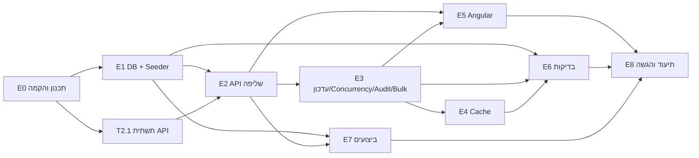

# PLAN – מערכת לניהול פניות (מבדק Full Stack)

> המסמך מתרגם את דרישות המבדק לתוכנית עבודה: ארכיטקטורה, חוזה API, משימות עם תלויות והערכות מאמץ, וטבלת קישור בין כל דרישה למשימות שמכסות אותה.
> הוא נשמר ב־repo ומתעדכן במהלך הפיתוח. בסוף כל משימה הסטטוס בטבלה מתעדכן.

---

## 1. מבנה הפתרון

```
/
├─ README.md                    ← מדריך לבודק, הרצה ותיעוד הפתרון (דרישה 11)
├─ PLAN.md                      ← המסמך הזה (דרישה 9)
├─ docs/
│  ├─ INSTALL.he.md             ← התקנת סביבה ב־Windows
│  ├─ PERFORMANCE.md            ← מדידות, אינדקסים, Bottlenecks (דרישה 6)
│  └─ performance/
│     ├─ measure.sql            ← סקריפט מדידה להרצה חוזרת
│     └─ plans/                 ← Execution Plans בפועל (.sqlplan), לפני ואחרי כל אינדקס
├─ scripts/                     ← התקנה ובדיקת סביבה ב־Windows
├─ docker-compose.yml           ← sqlserver + api + web + seeder
├─ .github/workflows/ci.yml     ← Build + Tests בכל Push
├─ backend/
│  ├─ RequestsManagement.sln
│  ├─ src/
│  │  ├─ RequestsManagement.Api/             ← HTTP בלבד: Controllers, ETag/If-Match, ProblemDetails, הרכבת DI
│  │  ├─ RequestsManagement.Application/     ← הלוגיקה, בלי EF Core ובלי ASP.NET Core
│  │  │    Entities/      ← ServiceRequest, RequestStatusHistory, StatusTransitions
│  │  │    Contracts/     ← DTOs, פרמטרי שאילתה, ולידטורים
│  │  │    Services/      ← שליפה, עדכון (כולל Bulk), Summary
│  │  │    Abstractions/  ← IRequestRepository, ISummaryCache (ממומשים ב־Infrastructure)
│  │  └─ RequestsManagement.Infrastructure/  ← EF Core: DbContext, Configurations ואינדקסים, Migrations, Repository, Cache
│  ├─ tools/RequestsManagement.Seeder/       ← יצירה חוזרת של 100,000 רשומות
│  └─ tests/
│     ├─ RequestsManagement.UnitTests/
│     └─ RequestsManagement.IntegrationTests/
└─ frontend/requests-web/                    ← Angular
```

**כיוון התלויות:** `Api → Application ← Infrastructure`. שכבת Application לא מכירה אף שכבה אחרת. היא מגדירה ממשקים, ו־Infrastructure מממשת אותם. ה־Api מכיר את Infrastructure רק דרך `AddInfrastructure()`. כך הקומפיילר אוכף את ההפרדה: שירות ב־Application לא יכול להשתמש ב־`DbContext` ישירות, ואפשר לבדוק את השירותים ב־Unit Tests בלי בסיס נתונים.

**Lifetimes:** `DbContext`, ה־Repository והשירותים הם Scoped (לבקשה). `ISummaryCache` ו־`TimeProvider` הם Singleton.

**נמנעים בכוונה מ־Over-Engineering:** אין CQRS, MediatR, Generic Repository או Microservices. יש Repository ייעודי אחד לפניות, עם המתודות שהמערכת צריכה בלבד.

---

## 2. מודל נתונים ואינדקסים

### טבלה `Requests`
| עמודה | טיפוס | הערות |
|---|---|---|
| Id | `int IDENTITY` PK (Clustered) | |
| Title | `nvarchar(200)` NOT NULL | |
| OrganizationName | `nvarchar(200)` NOT NULL | |
| Status | `tinyint` NOT NULL | Enum: New=0, InProgress=1, Waiting=2, Completed=3 |
| Priority | `tinyint` NOT NULL | Enum: Low=0, Medium=1, High=2 |
| AssignedTo | `nvarchar(100)` NULL | פנייה חדשה יכולה להיות לא משויכת |
| CreatedAt | `datetime2(3)` NOT NULL | UTC |
| UpdatedAt | `datetime2(3)` NOT NULL | UTC, מתעדכן בכל שינוי |
| RowVersion | `rowversion` | מתעדכן אוטומטית ב־DB, משמש Concurrency Token |

### טבלה `RequestStatusHistory`
| עמודה | טיפוס |
|---|---|
| Id | `bigint IDENTITY` PK |
| RequestId | `int` FK → Requests |
| PreviousStatus | `tinyint` |
| NewStatus | `tinyint` |
| ChangedAt | `datetime2(3)` UTC |
| ChangedBy | `nvarchar(100)` |

### אינדקסים (הגרסה הראשונה; כווננה אחרי המדידה ב־T7.1 – הגרסה הסופית והנימוקים ב־docs/PERFORMANCE.md)
| אינדקס | עמודות | תרחיש שהוא משרת |
|---|---|---|
| `IX_Requests_Status_CreatedAt` | (Status, CreatedAt DESC) INCLUDE (Priority) | סינון לפי סטטוס עם מיון ברירת מחדל (החדשות קודם), ו־Aggregation לפי סטטוס ועדיפות |
| `IX_Requests_CreatedAt` | (CreatedAt DESC) | הרשימה ללא סינון ממוינת לפי תאריך, וטווח תאריכים |
| `IX_Requests_AssignedTo_Status` | (AssignedTo, Status) | "הפניות של מטפל X" |
| `IX_Requests_OrganizationName` | (OrganizationName) | סינון לפי ארגון, ו־Lookup של רשימת הארגונים |
| `IX_Requests_Priority_Status` | (Priority, Status) | סינון ו־Aggregation לפי עדיפות |
| `IX_RequestStatusHistory_RequestId_ChangedAt` | (RequestId, ChangedAt DESC) | היסטוריית פנייה, ו"מי שינה אחרון" בתשובת 409 |

אינדקסים שלא יוכיחו תועלת במדידה יוסרו. המטרה היא סט מינימלי ומנומק, לא אינדקס לכל עמודה. בגרסה הראשונה האינדקסים צרים בכוונה (בלי עמודות טקסט ב־INCLUDE): העמוד המבוקש הוא עד 100 שורות, ו־Key Lookup עבורן זול. המדידה תאשר או תפריך את זה.

### Seeder (נתוני בדיקה)
- 100,000 פניות. כ־500 ארגונים, כ־30 מטפלים, תאריכים מפוזרים על פני שנתיים, והתפלגות סטטוסים ועדיפויות לא אחידה (מציאותית).
- **דטרמיניסטי** (`Random` עם Seed קבוע), כך שכל הרצה מייצרת אותם נתונים ואפשר להשוות מדידות.
- **היסטוריה עקבית:** לכל פנייה שאינה "חדשה" נוצרת היסטוריה שעוברת רק במעברים מותרים ומסתיימת בסטטוס הנוכחי, ו־`UpdatedAt` שווה לזמן השינוי האחרון.
- **יצירה חוזרת:** הפקודה מנקה את הטבלאות ומייצרת מחדש. כתיבה ב־`SqlBulkCopy` לוקחת שניות ולא דקות, ואחריה בנייה מחדש של האינדקסים ועדכון סטטיסטיקות.
- הרצה: ב־`docker compose up` הראשון הנתונים נוצרים אוטומטית (אם בסיס הנתונים ריק). יצירה מחדש: `docker compose run --rm seeder --reseed` (אפשר להוסיף `--count 250000`).

---

## 3. חוזה ה־API

כל השגיאות מוחזרות כ־**ProblemDetails** (RFC 9457), כולל `traceId`.

| Method | Route | תיאור | תגובות |
|---|---|---|---|
| GET | `/api/requests` | רשימה עם סינון, חיפוש, מיון ודפדוף | 200 `PagedResult<RequestListItemDto>`, 400 |
| GET | `/api/requests/{id}` | פנייה בודדת, כולל `allowedNextStatuses`, וכותרת `ETag` עם הגרסה | 200, 404 |
| GET | `/api/requests/summary` | Aggregations (מקבל את אותם פרמטרי סינון) | 200, 400 |
| PATCH | `/api/requests/{id}/status` | עדכון סטטוס, עם כותרת `If-Match` | 200 `RequestDto` + `ETag` חדש, 400, 404, **409**, 422, 428 |
| GET | `/api/requests/{id}/history` | היסטוריית שינויים | 200, 404 |
| POST | `/api/requests/bulk/status` | עדכון של עד 100 פניות | 200 `BulkStatusUpdateResult`, 400 |
| GET | `/api/lookups` | רשימות מטפלים וארגונים לטופסי הסינון ולבחירת "משתמש נוכחי" | 200 |

### פרמטרים של `GET /api/requests`
`page` (ברירת מחדל 1, טווח 1–100,000) · `pageSize` (ברירת מחדל 20, טווח 1–100) · `status` (רשימה, למשל `status=New&status=Waiting`) · `priority` (רשימה) · `organizationName` (מתחיל ב־) · `assignedTo` (שם מדויק) · `createdFrom` / `createdTo` (ובתנאי `createdFrom <= createdTo`) · `search` (עד 100 תווים) · `sortBy` ∈ {`createdAt`, `updatedAt`, `priority`, `status`, `title`, `organizationName`} · `sortDirection` ∈ {`asc`, `desc`}

- מיון יציב: תמיד מתווסף `Id` כ־Tie-breaker, כדי שדפים לא "יקפצו".
- `sortBy` עובר Whitelist ולא נבנה כטקסט חופשי, כך שאין חשש ל־SQL Injection.

### תשובת `summary` (שתי Aggregations לפחות)
```json
{ "total": 100000,
  "byStatus":   [{ "status": "New", "count": 24890 }, ...],
  "byPriority": [{ "priority": "High", "count": 20112 }, ...] }
```

### עדכון סטטוס
```http
PATCH /api/requests/42/status
If-Match: "AAAAAAAAB9E="
X-User-Name: dana
Content-Type: application/json

{ "newStatus": "InProgress" }
```
הגרסה נשלחת בכותרת `If-Match`, המנגנון התקני של HTTP לעדכון מותנה. הלקוח מקבל אותה בכותרת `ETag` של `GET /api/requests/{id}`.

| מצב | קוד |
|---|---|
| עודכן | **200** עם הפנייה המעודכנת ו־`ETag` חדש |
| ערך סטטוס לא קיים, או אין `X-User-Name` | **400** (ValidationProblemDetails) |
| `If-Match` חסר | **428** Precondition Required |
| `If-Match: *` או ערך שאינו גרסה תקינה | **400**. `*` פירושו "דרוס כל מה שיש", בדיוק מה שהמנגנון נועד למנוע |
| הפנייה לא קיימת | **404** |
| מעבר אסור לפי מכונת המצבים | **422** עם `currentStatus` ו־`allowedNextStatuses` |
| הגרסה לא עדכנית (עדכון מתחרה) | **409** עם `currentState` (הפנייה כפי שהיא עכשיו) ו־`lastChange` (מי שינה, מה ומתי), כדי שה־UI יוכל להסביר למשתמש מה קרה |

**409 ולא 412:** ‏412 הוא הקוד הצמוד לכישלון `If-Match`. בחרנו 409 כי מבחינת הלקוח זו התנגשות עם המצב הנוכחי של המשאב, שאותה הוא יכול לפתור ולשלוח שוב (ההגדרה של 409 ב־RFC 9110). כך גם ב־Bulk, שבו אין `If-Match`, הפריט מקבל תוצאה `Conflict` באותו מושג. ההחלטה תנומק ב־README.

### Bulk (Partial Success)
```json
POST /api/requests/bulk/status
X-User-Name: dana
{ "newStatus": "Completed",
  "items": [ { "id": 1, "rowVersion": "..." }, { "id": 2, "rowVersion": "..." } ] }
→ 200
{ "requested": 2, "succeeded": 1, "failed": 1,
  "results": [ { "id": 1, "outcome": "Updated", "rowVersion": "..." },
               { "id": 2, "outcome": "Conflict", "message": "..." } ] }
```
- `outcome` ∈ {`Updated`, `NotFound`, `Conflict`, `InvalidTransition`}.
- כאן הגרסה נמצאת בגוף הבקשה, לכל פריט בנפרד: כותרת `If-Match` אחת לא יכולה לשאת 100 גרסאות.
- תשובת **400** על הבקשה כולה: יותר מ־100 פריטים, רשימה ריקה, או מזהים כפולים.
- מימוש: טוענים את כל הפניות בשאילתה אחת, ובודקים כל פריט לחוד (לא קיים, גרסה לא עדכנית, מעבר אסור). כל הפריטים התקינים נשמרים יחד בטרנזקציה אחת, כל אחד עם שורת ה־Audit שלו ועם בדיקת הגרסה שלו. אם פנייה השתנתה בין הקריאה לכתיבה, בסיס הנתונים דוחה את הטרנזקציה: מוציאים רק את הפנייה הזו (תוצאה `Conflict`) ושומרים שוב את השאר. כל סבב מוציא לפחות פנייה אחת, כך שהלולאה תמיד מסתיימת. (בתכנון המקורי: טרנזקציה לכל פריט. השינוי חוסך עד 100 סבבים מול בסיס הנתונים, עם אותה התנהגות כלפי הלקוח.)
- התשובה היא 200 גם כשחלק מהפריטים נכשלו, כי הבקשה עובדה בהצלחה והתוצאה לכל פריט מופיעה בגוף התשובה. 207 Multi-Status הוא חלופה שתתועד.

---

## 4. Concurrency ו־Audit: איך זה נאכף בשרת וב־DB

### כללי מעבר סטטוס (מכונת מצבים)
| מ־ \ אל | New | InProgress | Waiting | Completed |
|---|---|---|---|---|
| **New** | – | ✔ | ✔ | ✖ |
| **InProgress** | ✖ | – | ✔ | ✔ |
| **Waiting** | ✖ | ✔ | – | ✔ |
| **Completed** | ✖ | ✔ (פתיחה מחדש) | ✖ | – |

מעבר לאותו סטטוס נחשב מעבר לא חוקי ומחזיר 422. הכללים נמצאים במקום אחד ב־Domain (`StatusTransitions`), והשרת מחזיר `allowedNextStatuses` בכל פנייה, כך שה־UI מציג רק מעברים מותרים ולא מחזיק עותק משלו של הכללים.

### זהות המשנה (ChangedBy)
המבדק לא דורש מערכת התחברות. ה־UI מציג בחירת "משתמש נוכחי" מתוך רשימת המטפלים, ושולח את השם בכותרת `X-User-Name` בכל עדכון. ערכי כותרות HTTP הם ASCII בלבד, ולכן שם בעברית נשלח מקודד (`encodeURIComponent`), והשרת מפענח אותו. השרת מוודא שהכותרת קיימת (אחרת 400) ושומר אותה ב־Audit. זו מגבלה ידועה שתתועד ב־README: בסביבת אמת הזהות תילקח מטוקן הזדהות (JWT) ולא מהלקוח.

### תהליך העדכון
1. הלקוח שולח ב־`If-Match` את ה־`ETag` שקיבל בשליפה (ערך ה־`rowversion`).
2. השרת טוען את הפנייה (או מחזיר 404) ובודק את חוקיות המעבר (או מחזיר 422).
3. ה־`OriginalValue` של `RowVersion` מוגדר לערך שהלקוח שלח. EF Core מייצר `UPDATE ... WHERE Id=@id AND RowVersion=@original`.
4. באותה טרנזקציה מתעדכן `UpdatedAt` ונוספת שורה ל־`RequestStatusHistory`.
5. אם אף שורה לא עודכנה, נזרק `DbUpdateConcurrencyException`. השרת טוען את המצב העדכני ואת שורת ההיסטוריה האחרונה, ומחזיר **409** עם `currentState` ו־`lastChange`. ה־Audit של הניסיון שנכשל לא נשמר, כי זו אותה טרנזקציה.
6. הבדיקה מתבצעת **בתוך ה־UPDATE**, כך שאין חלון זמן בין הבדיקה לכתיבה. ה־`rowversion` מתעדכן אוטומטית ב־DB, ולכן אין Lost Update גם כששני עדכונים מגיעים באותה מילישנייה.

---

## 5. Cache
- **מה נשמר:** תוצאת `summary` **ללא סינון** (תמונת המצב הכללית שמוצגת בכל טעינת מסך). זו שאילתת Aggregation על 100 אלף רשומות שנקראת הרבה ומשתנה רק כשמתבצע עדכון סטטוס. Summary עם סינון לא נשמר, כי מספר הצירופים גדול וההסתברות לפגיעה ב־Cache נמוכה.
- **Expiration:** `AbsoluteExpiration` של 60 שניות, כרשת ביטחון.
- **Invalidation:** כל עדכון סטטוס מוצלח, בודד או Bulk, מסיר את המפתח מה־Cache.
- **מימוש:** `IMemoryCache` מאחורי ממשק `ISummaryCache`.
- **הרחבה למספר מופעי שרת:** החלפת המימוש ל־`IDistributedCache` (Redis). המופע שמעדכן מוחק את המפתח המשותף, ואם יש גם Cache מקומי, נשלחת הודעת Invalidation ב־Redis Pub/Sub. אפשר גם להשתמש ב־HybridCache של .NET עם Tags. החלופה תתועד ולא תמומש, כדי לא להוסיף מורכבות שאין בה צורך.

---

## 6. ביצועים: מה נמדד
נמדדות שתי פעולות מרכזיות על 100 אלף הרשומות, **לפני ואחרי** הוספת האינדקסים:
1. `GET /api/requests` עם סינון סטטוס, טווח תאריכים, מיון לפי CreatedAt DESC ודף 1 וגם דף עמוק.
2. `GET /api/requests/summary` (Aggregations).

שלוש דרכי מדידה:
- `SET STATISTICS IO, TIME ON`: מספר Logical Reads וזמן CPU.
- Actual Execution Plan: Seek מול Scan, ו־Key Lookups.
- זמני תגובה של ה־API (ממוצע של כמה קריאות לכל תרחיש).

**ראיות שנשמרות ב־repo:** הסקריפט `docs/performance/measure.sql` (מריץ את אותן שאילתות ש־EF Core מייצר, עם ובלי כל אינדקס), ו־Execution Plans בפועל (`.sqlplan`) לפני ואחרי כל אינדקס או תיקון, בתיקייה `docs/performance/plans/`. כל מספר ב־`PERFORMANCE.md` יגיע ממדידה, וה־SQL יילקח מהלוג של EF Core.

**Bottlenecks צפויים, שאת קיומם יש לאמת:**
- `LIKE '%x%'` לא יכול להשתמש ב־Seek. **שיפור:** Full-Text Index, או חיפוש בתחילת מילה (`LIKE 'x%'`).
- `COUNT(*)` על סינון רחב. **שיפור:** Cache או ספירה משוערת.
- Offset עמוק. **שיפור:** Keyset Pagination.

**אין טעינה לזיכרון:** כל הסינון, המיון והדפדוף מתבצעים ב־`IQueryable`, ומתורגמים ל־SQL אחד עם `OFFSET/FETCH`. השליפה מתבצעת עם `AsNoTracking` ו־Projection ישיר ל־DTO (`Select`), כך שנשלפות רק העמודות הנדרשות.

---

## 7. Angular: ארכיטקטורה
**ממשק בעברית, מימין לשמאל (RTL)**, עם Angular Material. ההשקעה היא בבהירות ולא בעיצוב גרפי.

| יחידה | אחריות |
|---|---|
| `RequestsApiService` | קריאות HTTP בלבד, בלי State. שולח `If-Match` בעדכון |
| `RequestsListStore` (Service) | State של הרשימה. **ה־URL הוא מקור האמת:** סינון, מיון, עמוד והפנייה הפתוחה נשמרים בכתובת, ורענון, קישור או Back מציגים את אותה תצוגה. שינוי בחיפוש עובר `debounceTime(300)` ו־`distinctUntilChanged`, וכל שינוי עובר `switchMap` שמבטל בקשה קודמת שעוד לא חזרה. מצב: `{ loading, error, data }` |
| `SummaryStore` | טעינת ה־Aggregations לפי אותם סינונים, ורענון אחרי עדכון |
| `RequestsPageComponent` (Container) | מחבר בין ה־Stores לרכיבי התצוגה |
| `RequestsFiltersComponent` | חיפוש, סטטוס, עדיפות, ארגון, מטפל וטווח תאריכים (Presentational) |
| `RequestsTableComponent` | טבלה, מיון, דפדוף ובחירה מרובה (Presentational) |
| `SummaryPanelComponent` | הצגת ה־Aggregations |
| `RequestDetailsDrawerComponent` | **מגירת פרטים** שנפתחת לצד הרשימה: פרטי הפנייה, עדכון סטטוס (רק מעברים מ־`allowedNextStatuses`) והיסטוריית השינויים |
| `ConflictDialogComponent` | חלון שנפתח ב־**409**: מה המצב עכשיו, מי שינה ומתי, ומה המשתמש ניסה לשמור. שתי פעולות: **"הצגת המצב העדכני"**, או **"להעביר בכל זאת"** (שליחה חוזרת מול הגרסה החדשה, רק אם המעבר עדיין מותר). המערכת לא מחליטה מי צודק, המשתמש מחליט |
| `BulkActionsBarComponent` | פעולת Bulk והצגת תוצאה לכל פנייה, עם קישור לפנייה שלא עודכנה |
| `CurrentUserService` + בורר בכותרת | "משתמש נוכחי", נשלח בכותרת `X-User-Name` |
| `HttpInterceptor` | הוספת `X-User-Name`, וזיהוי מצב "אין חיבור לשרת" |

**מצבי UI:**
- **Loading:** Spinner, והטבלה הקודמת נשארת מעומעמת.
- **Empty:** "לא נמצאו פניות התואמות לסינון".
- **Error:** הודעה שנבנית ממה שהשרת החזיר (איזה שדה לא תקין, אילו מעברים מותרים), עם כפתור "נסה שוב".
- **אין חיבור לשרת:** באנר אחד עם "ניסיון חוזר", במקום שגיאה בכל חלק במסך.

---

## 8. תוכנית עבודה: משימות, תלויות והערכת מאמץ

ההערכות הן בשעות עבודה של מפתח/ת. סטטוס: ⬜ לא התחיל · 🔄 בעבודה · ✅ הושלם.

### E0 – תכנון והקמה
| ID | משימה | מה נדרש | תוצר | תלוי ב־ | מאמץ | דרישה | סטטוס |
|---|---|---|---|---|---|---|---|
| T0.1 | ניתוח אפיון ותוכנית עבודה | פירוק הדרישות, החלטות ושאלות פתוחות | `PLAN.md` | – | 2h | 9 | ✅ |
| T0.2 | שלד README | מבנה ה־README בסגנון "מדריך לבודק" (ראו T8.1), עם טיוטת ההחלטות הטכנולוגיות והחלופות | `README.md` ראשוני | T0.1 | 1h | 11 | ✅ |
| T0.3 | הקמת Repo ו־Solution | שלוש שכבות (Api, Application, Infrastructure) עם כיוון תלויות נכון, `.editorconfig`, `.gitignore`, `Directory.Build.props` | Solution שעובר Build | T0.1 | 2h | 10 | ✅ |
| T0.4 | שלד Docker ו־CI | `docker-compose` עם SQL Server, ו־GitHub Actions ל־Build ו־Test | Pipeline ירוק | T0.3 | 2h | הגשה | ✅ |
| T0.5 | סביבת הרצה מקומית ב־Windows | סקריפט התקנה (WSL 2, Git, Docker Desktop, .NET 10 SDK, Node LTS), סקריפט אימות, ומדריך התקנה והרצה בעברית | `scripts/setup-windows.ps1`, `scripts/verify-windows.ps1`, `docs/INSTALL.he.md`, ומחשב המפתחת מוכן להרצה | T0.1 | 1.5h | 11, הגשה | ✅ |

### E1 – בסיס נתונים ונתוני בדיקה
| ID | משימה | מה נדרש | תוצר | תלוי ב־ | מאמץ | דרישה | סטטוס |
|---|---|---|---|---|---|---|---|
| T1.1 | תכנון מודל ואינדקסים | טבלאות, טיפוסים, אינדקסים מנומקים | סעיף 2 במסמך, ERD | T0.1 | 1.5h | מבנה פנייה, 6 | ✅ |
| T1.2 | Entities, DbContext ו־Migration | Entities ב־Application, ו־Configurations ב־Infrastructure: `rowversion`, Enums כ־tinyint, אינדקסים | Migration ראשון שרץ | T0.3, T1.1 | 2h | מבנה פנייה, 2 | ✅ |
| T1.3 | Seeder של 100 אלף רשומות | דטרמיניסטי, `SqlBulkCopy`, ניתן להרצה חוזרת | פקודת Seed שמסיימת בשניות | T1.2 | 3h | יצירת נתונים | ✅ |

### E2 – API שליפה
| ID | משימה | מה נדרש | תוצר | תלוי ב־ | מאמץ | דרישה | סטטוס |
|---|---|---|---|---|---|---|---|
| T2.1 | תשתית API | DI ו־Lifetimes, `AddProblemDetails` ו־`IExceptionHandler`, Logging, OpenAPI/Swagger, טיפול ב־`ETag`/`If-Match` | API עולה, שגיאות כ־ProblemDetails | T0.3 | 3h | 10 | ✅ |
| T2.2 | DTOs, Mapping ו־Validation | מודל Query, ולידטורים (FluentValidation), Mapping ידני ומרוכז | Validation עקבי ו־400 ברור | T2.1, T1.2 | 2h | 1, 10 | ✅ |
| T2.3 | שירות ו־Repository לשליפה | סינון משולב, חיפוש, מיון Whitelist, דפדוף, `AsNoTracking`, Projection, `CancellationToken` | `GET /api/requests` | T2.2 | 3h | 1 | ✅ |
| T2.4 | פנייה בודדת ו־Lookups | `GET /{id}` עם `ETag`, `allowedNextStatuses` ו־404, ו־`GET /api/lookups` | שני Endpoints | T2.3, T3.1 | 1.5h | 1, 2 | ✅ |
| T2.5 | Aggregations | ספירה לפי סטטוס ולפי עדיפות, עם אותם סינונים | `GET /summary` | T2.3 | 1.5h | 1 | ✅ |

### E3 – עדכון, Concurrency ו־Audit
| ID | משימה | מה נדרש | תוצר | תלוי ב־ | מאמץ | דרישה | סטטוס |
|---|---|---|---|---|---|---|---|
| T3.1 | כללי מעבר סטטוס | מכונת מצבים ב־Domain | `StatusTransitions` עם בדיקות | T1.2 | 1h | 2 | ✅ |
| T3.2 | עדכון סטטוס | `If-Match` (428/400), ‏404/400/422, ‏409 עם `currentState` ו־`lastChange`, RowVersion, `UpdatedAt`, Audit באותה טרנזקציה, Logging | `PATCH /{id}/status` | T3.1, T2.1 | 4h | 2, 3 | ✅ |
| T3.3 | היסטוריית שינויים | שליפה ממוינת לפי תאריך | `GET /{id}/history` | T3.2 | 1h | 3 | ✅ |
| T3.4 | Bulk (Partial Success) | ולידציה (עד 100, ללא כפילויות), טעינה בשאילתה אחת, שמירה לכל פריט, תוצאה מפורטת | `POST /bulk/status` | T3.2 | 3h | 4 | ✅ |

### E4 – Cache
| ID | משימה | מה נדרש | תוצר | תלוי ב־ | מאמץ | דרישה | סטטוס |
|---|---|---|---|---|---|---|---|
| T4.1 | Cache ל־Summary | `ISummaryCache`, Expiration של 60 שניות, Invalidation בעדכון בודד וב־Bulk | Summary מהיר ותמיד עדכני | T2.5, T3.2, T3.4 | 1.5h | 7 | ✅ |

### E5 – Angular
| ID | משימה | מה נדרש | תוצר | תלוי ב־ | מאמץ | דרישה | סטטוס |
|---|---|---|---|---|---|---|---|
| T5.1 | הקמת פרויקט | Angular, Material, RTL ועברית, Proxy ל־API, Models, `RequestsApiService`, Interceptor, משתמש נוכחי, באנר "אין חיבור לשרת" | אפליקציה שמתחברת ל־API | T2.3 | 2.5h | 5 | ✅ |
| T5.2 | Store לרשימה | סנכרון עם ה־URL, Debounce, `switchMap`, ומצבי Loading/Empty/Error | `RequestsListStore` | T5.1 | 4h | 5 | ✅ |
| T5.3 | טבלה, סינון, מיון ודפדוף | רכיבי תצוגה, כשהכול מתבצע בצד השרת | מסך ראשי | T5.2 | 3.5h | 5 | ✅ |
| T5.4 | פאנל Aggregations | הצגה ורענון אחרי עדכון | `SummaryPanel` | T5.1, T2.5 | 1h | 5 | ✅ |
| T5.5 | מגירת פרטים | פרטים, עדכון סטטוס לפי `allowedNextStatuses`, היסטוריית שינויים, מזהה הפנייה ב־URL | `RequestDetailsDrawer` | T5.3, T3.2, T3.3 | 3h | 3, 5 | ✅ |
| T5.6 | טיפול ב־409 | `ConflictDialog`: מצב עכשיו, מי שינה ומתי, "הצגת המצב העדכני" / "להעביר בכל זאת" | חלון Conflict | T5.5 | 2h | 2, 5 | ✅ |
| T5.7 | Bulk ב־UI | בחירה מרובה, ביצוע, הצגת תוצאה לכל פנייה עם קישור לפנייה שלא עודכנה | Bulk מה־UI | T5.3, T3.4 | 2h | 4, 5 | ✅ |
| T5.8 | בדיקת ממשק בדפדפן אמיתי | מסלול הבודק ב־Playwright (חיפוש, רענון, 409, Bulk, אין חיבור, אין תוצאות) עם צילומי מסך; תיקון מה שנמצא | `scripts/ui/screenshots.mjs`, `docs/screenshots` | T5.7 | 2h (לא תוכנן) | 5 | ✅ |

### E6 – בדיקות אוטומטיות
| ID | משימה | מה נדרש | תוצר | תלוי ב־ | מאמץ | דרישה | סטטוס |
|---|---|---|---|---|---|---|---|
| T6.1 | Unit Tests | מעברי סטטוס, ולידציה של Query ושל Bulk | xUnit | T3.1, T2.2 | 1.5h | 8 | ✅ |
| T6.2 | תשתית Integration | `WebApplicationFactory` עם **Testcontainers** (SQL Server אמיתי) | Fixture משותף | T1.2, T2.1 | 2h | 8 | ✅ |
| T6.3 | Integration Tests | (1) סינון ודפדוף תקינים (2) 404 (3) **Concurrency: שני עדכונים עם אותו `If-Match`, אחד מקבל 200 והשני 409 עם `lastChange`, ונשמרת שורת היסטוריה אחת** (4) `If-Match` חסר מחזיר 428 (5) Bulk חלקי (6) Invalidation של Cache | בדיקות ירוקות ב־CI | T6.2, T3.4, T4.1 | 3.5h | 8 | ✅ |
| T6.4 | בדיקות Angular | Store: `debounce`, `switchMap` וסנכרון URL. טיפול ב־409 בממשק | בדיקות לקוח | T5.2 | 1h | 8 | ✅ |

### E7 – ביצועים
| ID | משימה | מה נדרש | תוצר | תלוי ב־ | מאמץ | דרישה | סטטוס |
|---|---|---|---|---|---|---|---|
| T7.1 | מדידה לפני ואחרי אינדקסים | STATISTICS IO/TIME, Execution Plans וזמני API, לשתי פעולות לפחות | `measure.sql`, קבצי `.sqlplan`, טבלת תוצאות | T1.3, T2.3, T2.5 | 4h | 6 | ✅ |
| T7.2 | Bottleneck והצעת שיפור | ניתוח והמלצה, כולל ניסוי מדוד של השיפור | `docs/PERFORMANCE.md` | T7.1 | 1h | 6 | ✅ |
| T7.3 | כוונון אינדקסים לפי המדידה | המדידה הראשונה גילתה שסדר האינדקסים לא תאם את ה־ORDER BY; תיקון + Migration + מדידה חוזרת | Migration `TuneIndexes`, `runs/2-tuned` | T7.1 | 2h (לא תוכנן) | 6 | ✅ |

### E8 – תיעוד והגשה
| ID | משימה | מה נדרש | תוצר | תלוי ב־ | מאמץ | דרישה | סטטוס |
|---|---|---|---|---|---|---|---|
| T8.1 | README | בסגנון "מדריך לבודק": טבלת מסמכים, הרצה בדקות, מסלול בדיקה בממשק (מה עושים, מה אמור לקרות, איזו דרישה), הדגמת 409 משתי פקודות, טבלת "איפה כל דרישה" (קוד, בדיקות, תיעוד), פתרון תקלות. אחר כך: טכנולוגיות וגרסאות, מבנה, API, בסיס נתונים ואינדקסים, ביצועים, Concurrency, Bulk, Cache, שתי החלטות עם טבלת חלופות, מגבלות ידועות (השפעה שנמדדה, תיקון, הערכה), Logging, שימוש ב־AI | `README.md` | הכול | 4h | 11 | ⬜ |
| T8.2 | Docker Compose מלא | API, Web (nginx) ו־Seeder, ובדיקה על מכונה נקייה | `docker compose up` עובד | T0.4, T5.7 | 2h | הגשה | ⬜ |
| T8.3 | ביקורת סופית מול מחוון הציון | מעבר על כל סעיף בטבלת ההערכה | Checklist ירוק | T8.1, T8.2 | 1h | הכול | ⬜ |

**סה"כ הערכה:** כ־74.5 שעות עבודה (E0: 8.5 · E1: 6.5 · E2: 11 · E3: 9 · E4: 1.5 · E5: 18 · E6: 8 · E7: 5 · E8: 7).

### סדר ביצוע ותלויות


**שלבי ביצוע (כל שלב מסתיים ב־Commit ובבדיקה שלך):**
1. **שלב א' – יסודות:** T0.2 ← T0.3 ← T0.4 ← T1.2 ← T1.3. אחרי השלב: DB עם 100 אלף רשומות ו־CI ירוק.
2. **שלב ב' – Backend מלא:** T2.1 עד T2.5, אחריהן T3.1 עד T3.4, ואחריהן T4.1. במקביל: T6.1 ו־T6.2, ובדיקות T6.3 נכתבות ביחד עם הפיצ'רים.
3. **שלב ג' – מדידת ביצועים:** T7.1 ו־T7.2. השלב בא מוקדם בכוונה, כדי שאם המדידה תדרוש שינוי אינדקסים, הוא ייעשה לפני ה־UI.
4. **שלב ד' – Angular:** T5.1 עד T5.7.
5. **שלב ה' – הגשה:** T8.2, T8.1, T8.3.

---

## 9. קישור בין דרישות המבדק למשימות
| # | דרישה | משימות |
|---|---|---|
| – | מבנה פנייה ו־100 אלף רשומות שניתנות ליצירה חוזרת | T1.1, T1.2, T1.3 |
| 1 | שליפת נתונים (Pagination, Filtering, Search, Sort, Aggregations, Validation, CancellationToken, DTOs) | T2.2, T2.3, T2.4, T2.5, T7 |
| 2 | עדכון סטטוס ו־Concurrency | T3.1, T3.2, T5.6, T6.3 |
| 3 | היסטוריית שינויים | T3.2, T3.3, T5.5 |
| 4 | Bulk | T3.4, T5.7, T6.3 |
| 5 | Angular | T5.1–T5.7 |
| 6 | ביצועים | T1.1, T7.1, T7.2, `docs/performance/*` |
| 7 | Cache | T4.1, T6.3 |
| 8 | בדיקות אוטומטיות (4 לפחות, אחת מהן Integration) | T6.1–T6.4 |
| 9 | תכנון עבודה | T0.1 (המסמך הזה) |
| 10 | איכות קוד (DI, Async, ProblemDetails, Validation, Logging) | T0.3, T2.1, T2.2 |
| 11 | תיעוד (כולל הוראות הפעלה) | T0.2, T0.5, T8.1, `docs/*` |
| – | הגשה נגישה (לא ZIP) | T0.4, T0.5, T8.2 |

---

## 10. סיכונים ונקודות פתוחות
| נושא | מצב / פתרון |
|---|---|
| ChangedBy בלי הזדהות | ✅ הוחלט: `X-User-Name` (סעיף 4), מתועד כמגבלה ידועה |
| **סביבת הבנייה של Claude** | ✅ נפתר: בסביבת הענן אין גישה ל־NuGet, npm ו־Docker Hub, ולכן כל Push ל־GitHub מריץ ב־**GitHub Actions** את ה־Build, הבדיקות והרצת Docker Compose מלאה עם 100,000 פניות. Migrations נוצרות ב־workflow ייעודי (`generate-migration.yml`). את מריצה מקומית עם Docker Desktop |
| חשבון GitHub | ✅ `rikiz-coder/requests-management-system` (ציבורי), מחובר ומאפשר Push |
| SQL Server על מחשבי Mac עם ARM | ה־Image רץ באמולציה. יתועד ב־README |
| מועד הגשה | סוף השבוע. כל המשימות, כולל T6.4, נכנסות לתוכנית |

---

## 11. שימוש בכלי AI (יתועד ב־README)
ייכתב לפי מה שקרה בפועל: אילו חלקים נכתבו בעזרת AI, ומה נבדק ושונה ידנית. בין השאר: אימות Execution Plans, הרצת בדיקות ה־Concurrency, ובדיקה ידנית של ה־UI מול 409. ייכתב בטבלה: שלב, מה עשה הכלי, מה הוחלט, ומה נבדק.
