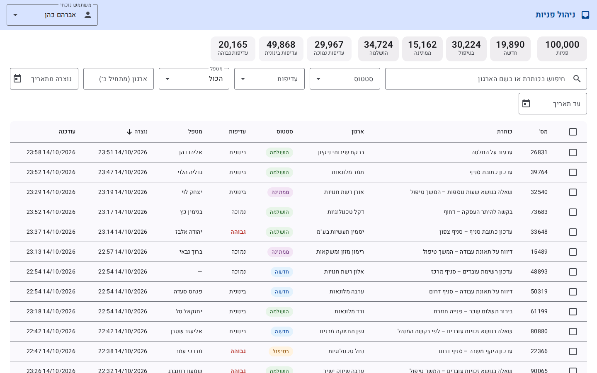
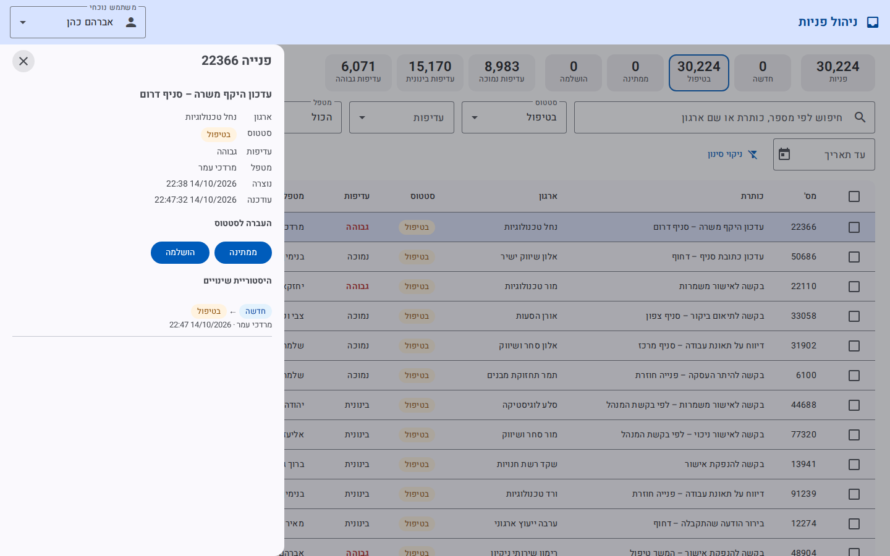
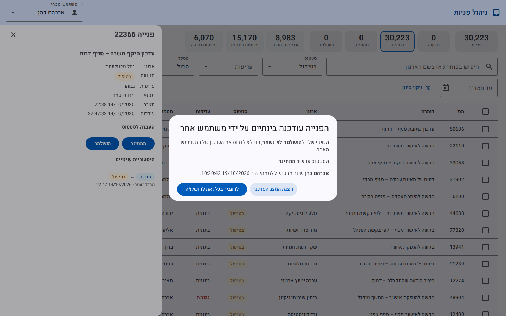
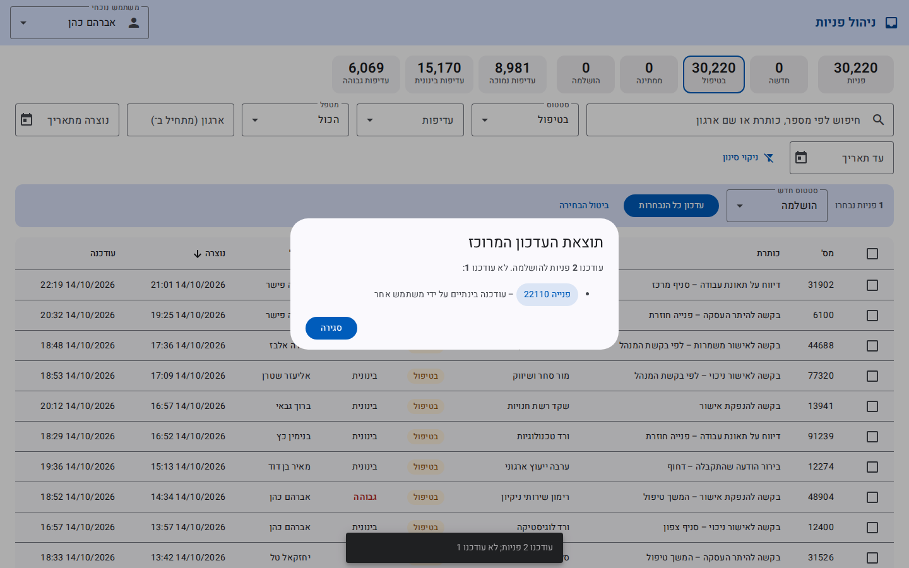

# מערכת לניהול פניות – מבדק Full Stack

[](https://github.com/rikiz-coder/requests-management-system/actions/workflows/ci.yml)

מערכת לניהול פניות שמגיעות מארגונים ומעסיקים. כמה משתמשים עובדים בה במקביל על 100,000 פניות: איתור, סינון, מיון ודפדוף בצד השרת, עדכון סטטוס עם הגנה מפני עדכונים מתחרים, עדכון מרוכז (Bulk), היסטוריית שינויים ונתונים מסכמים.

| מסמך | מה יש בו |
|---|---|
| README (כאן) | מדריך לבודק, הרצה, טכנולוגיות, מבנה, בסיס נתונים, Concurrency, Bulk, Cache, החלטות, מגבלות, שימוש ב־AI |
| [PLAN.md](PLAN.md) | פירוק האפיון למשימות: תוצרים, תלויות, סדר ביצוע, הערכת מאמץ וקישור לדרישות |
| [docs/INSTALL.he.md](docs/INSTALL.he.md) | התקנת הסביבה ב־Windows (Git, Docker Desktop, ‎.NET, Node) |
| [docs/PERFORMANCE.md](docs/PERFORMANCE.md) | מדידות על 100,000 פניות: Execution Plans, אינדקסים, צווארי בקבוק ושיפורים שנמדדו |
| [docs/performance/measure.sql](docs/performance/measure.sql) | סקריפט המדידה (רץ גם ב־SSMS) |

---

## מדריך לבודק

### הרצה

**דרישות:** Docker Desktop (או Docker Engine עם Compose). זה הכול – אין צורך ב־‎.NET, ב־Node או ב־SQL Server מקומי. להתקנה ב־Windows: [docs/INSTALL.he.md](docs/INSTALL.he.md).

```powershell
git clone https://github.com/rikiz-coder/requests-management-system.git
cd requests-management-system
docker compose up -d --build
```

ההרצה הראשונה בונה את ה־Images, מרימה SQL Server 2022, יוצרת את בסיס הנתונים ומכניסה 100,000 פניות (כמה דקות בפעם הראשונה, בעיקר הורדות). אחר כך:

| מה | כתובת |
|---|---|
| **ממשק המשתמש** | **http://localhost:8080** |
| Swagger (תיעוד ה־API) | http://localhost:5080/swagger |
| בדיקת תקינות | http://localhost:5080/health |
| SQL Server (ל־SSMS) | `localhost,14333` · משתמש `sa` · סיסמה `Requests_Dev_Passw0rd!` |

**יצירה מחדש של נתוני הבדיקה** (מוחק הכול ויוצר מחדש, עם אותו Seed, כלומר אותם נתונים בדיוק):

```powershell
docker compose run --rm seeder --reseed                 # 100,000
docker compose run --rm seeder --reseed --count 250000  # כמות אחרת
```

**עצירה:** `docker compose down` (הנתונים נשמרים) · `docker compose down -v` (מוחק גם את הנתונים).

### מסלול בדיקה בממשק

| # | מה עושים | מה אמור לקרות | דרישה |
|---|---|---|---|
| 1 | פותחים את http://localhost:8080 | 100,000 פניות, 20 בעמוד, החדשות קודם; למעלה – סיכום לפי סטטוס ועדיפות | 1, 5 |
| 2 | מקלידים "היתר" בחיפוש, עם DevTools ← Network פתוח | בקשה אחת אחרי שמפסיקים להקליד (350ms). בקשה קודמת שעוד רצה מסומנת `(canceled)`. הרשימה והסיכום מתעדכנים יחד | 1, 5 |
| 3 | לוחצים על "ממתינה" ועל "עדיפות גבוהה" בסיכום (כל ריבוע מוסיף או מסיר סינון), ממיינים לפי עמודה, עוברים לעמוד 2 ולוחצים F5 | הסינון, המיון והעמוד נשמרים בכתובת, והרענון מציג אותה תצוגה | 1, 5 |
| 4 | לוחצים על פנייה (או מקלידים את המספר שלה בחיפוש, למשל `99236`) | נפתחת מגירה: פרטים, כפתורים רק למעברים המותרים, והיסטוריה | 2, 3 |
| 5 | **409:** מעתיקים את הכתובת (כולל `id=`) ללשונית שנייה. מעדכנים סטטוס בלשונית אחת, ואז בשנייה (בלי לרענן) | בלשונית השנייה נפתח חלון: מה המצב עכשיו, מי שינה ומתי, ו"להעביר בכל זאת" / "הצגת המצב העדכני". שום דבר לא נדרס | 2, 5 |
| 6 | **Bulk:** מסמנים כמה פניות. בלשונית אחרת משנים אחת מהן. חוזרים ובוחרים סטטוס ב"עדכון כל הנבחרות" | "עודכנו N פניות; לא עודכנה 1", עם הסיבה ("עודכנה בינתיים על ידי משתמש אחר") וקישור לפנייה | 4 |
| 4א | במגירה לוחצים על "פתיחה במסך מלא" (ריבוע עם חץ, ליד ה־X) | עמוד מלא `/requests/<מספר>`: פרטים ועדכון סטטוס, ציר זמן של ההיסטוריה, כמה זמן מאז שנוצרה ובסטטוס הנוכחי, וקישורים לפניות נוספות של הארגון ושל המטפל. "חזרה לרשימה" (או Back בדפדפן) מחזיר לאותה רשימה, עם אותו סינון ועמוד | 3, 5 |
| 7 | `docker compose stop api`, ואז משנים סינון; `docker compose start api` ולוחצים "ניסיון חוזר" | באנר אחד "אין חיבור לשרת", ואחרי החזרה הכול נטען מחדש | 5 |
| 8 | http://localhost:5080/swagger | כל ה־Endpoints, כולל קודי השגיאה | 11 |

כל המסלול הזה רץ גם אוטומטית בדפדפן אמיתי (Playwright, Chromium) – [`scripts/ui/screenshots.mjs`](scripts/ui/screenshots.mjs) – וצילומי המסך שלו נמצאים ב־[`docs/screenshots`](docs/screenshots).

| רשימה | פרטי פנייה | 409 | Bulk |
|---|---|---|---|
|  |  |  |  |

### לראות 409 משתי פקודות

שני "משתמשים" מעדכנים את אותה פנייה עם אותו `ETag`. מתיקיית הפרויקט, כשהמערכת רצה:

```powershell
powershell -ExecutionPolicy Bypass -File .\scripts\demo-409.ps1
```

הסקריפט בוחר פנייה במצב "בטיפול", קורא אותה פעם אחת, ושולח שני עדכונים עם אותה גרסה:

```text
Dana  -> Waiting:   HTTP 200
Yossi -> Completed: HTTP 409
Body of the 409 response:
{"title":"Concurrency conflict","status":409,"detail":"Request … was modified by another user. Reload it and try again.",
 "currentState":{"id":…,"status":"Waiting","version":"…","allowedNextStatuses":["InProgress","Completed"],…},
 "lastChange":{"previousStatus":"InProgress","newStatus":"Waiting","changedAt":"…Z","changedBy":"Dana"}}
Without If-Match:   HTTP 428
```

אותו דבר ב־Bash (Git Bash / Mac / Linux):

```bash
ID=$(curl -s "http://localhost:5080/api/requests?status=InProgress&pageSize=1" | grep -o '"id":[0-9]*' | head -1 | cut -d: -f2)
ETAG=$(curl -si http://localhost:5080/api/requests/$ID | grep -i '^etag:' | cut -d' ' -f2 | tr -d '\r')
curl -s -o /dev/null -w "Dana:  %{http_code}\n" -X PATCH http://localhost:5080/api/requests/$ID/status \
  -H "If-Match: $ETAG" -H "X-User-Name: Dana" -H "Content-Type: application/json" -d '{"newStatus":"Waiting"}'
curl -s -w "\nYossi: %{http_code}\n" -X PATCH http://localhost:5080/api/requests/$ID/status \
  -H "If-Match: $ETAG" -H "X-User-Name: Yossi" -H "Content-Type: application/json" -d '{"newStatus":"Completed"}'
```

הסקריפט רץ גם ב־CI מול המערכת המלאה, כך שהפלט שלמעלה נבדק בכל שינוי.

### בדיקות אוטומטיות

```powershell
cd backend
dotnet test     # דורש ‎.NET 10 SDK ו־Docker פתוח: בדיקות ה־Integration מרימות SQL Server זמני משלהן
```

```powershell
cd frontend\requests-web
npm ci
npx ng test --watch=false   # 21 בדיקות לקוח (Vitest) – דורש Node.js
```

* **51 בדיקות Unit:** כללי מעברי סטטוס, שינוי סטטוס בישות, ולידציה (דפדוף, תאריכים, ערכים לא מוכרים, תווי בקרה בחיפוש, Bulk), פענוח `If-Match`, מחולל הנתונים.
* **37 בדיקות Integration** מול SQL Server 2022 אמיתי (Testcontainers) דרך ה־API עצמו (`WebApplicationFactory`): סינון, חיפוש, מיון ודפדוף מול ספירה ישירה בבסיס הנתונים; החיפוש דרך `SearchText` מחזיר בדיוק את מה ש־`LIKE` על הכותרת והארגון מחזיר, בלי התאמה על הגבול ביניהם ובלי תלות ברישיות; 400 לכל פרמטר לא תקין; Summary ו־Invalidation של ה־Cache; ‏404/409/422/428; **5 עדכונים מקבילים עם אותו `ETag` – בדיוק אחד מצליח ונכתבת שורת היסטוריה אחת**; Bulk עם הצלחה חלקית; Migrations, אינדקסים ו־Seed חוזר.

* **21 בדיקות לקוח (Vitest):** ה־Store – Debounce של החיפוש (בקשה אחת אחרי שההקלדה נעצרת), ביטול בקשה קודמת (`switchMap`), שמירת הנתונים הקודמים בזמן טעינה, סיכום שלא נטען מחדש בדפדוף, וסנכרון עם הכתובת; ההמרה בין הכתובת לשאילתה; הודעות השגיאה; ובמגירת הפרטים – `If-Match`, פתיחת חלון ה־409 ו"להעביר בכל זאת" מול הגרסה החדשה; המסך המלא – מעבר אליו עם מצב הרשימה, "חזרה לרשימה" שמשחזרת אותו, הקישורים לרשימות המסוננות, "הפנייה לא נמצאה" וחישובי הזמנים מההיסטוריה.

בדיקות אמיתיות מול SQL Server ולא מול ספק ה־InMemory של EF: הוא לא אוכף `rowversion`, ובדיקת Concurrency מולו הייתה עוברת גם אם המנגנון שבור.

### איפה כל דרישה

| דרישה | קוד | בדיקות | תיעוד |
|---|---|---|---|
| נתונים: מבנה פנייה, 100K רשומות, יצירה חוזרת | [`ServiceRequest`](backend/src/RequestsManagement.Application/Requests/Entities/ServiceRequest.cs), [`SeedDataGenerator`](backend/src/RequestsManagement.Infrastructure/Persistence/Seeding/SeedDataGenerator.cs), [`DatabaseSeeder`](backend/src/RequestsManagement.Infrastructure/Persistence/Seeding/DatabaseSeeder.cs) | `SeedDataGeneratorTests`, `SeedingTests` | [בסיס הנתונים](#בסיס-הנתונים) |
| 1 שליפה: דפדוף, סינון, חיפוש, מיון, Aggregations, ולידציה, Cancellation, DTOs | [`RequestRepository`](backend/src/RequestsManagement.Infrastructure/Persistence/Repositories/RequestRepository.cs), [`RequestQueryExtensions`](backend/src/RequestsManagement.Infrastructure/Persistence/Repositories/RequestQueryExtensions.cs), [`RequestValidators`](backend/src/RequestsManagement.Application/Requests/Validation/RequestValidators.cs), [`RequestQueryService`](backend/src/RequestsManagement.Application/Requests/Services/RequestQueryService.cs) | `SearchTests`, `SummaryAndDetailsTests`, `ValidatorTests` | [API](#api) |
| 2 עדכון סטטוס, מעברים, Optimistic Concurrency | [`RequestCommandService`](backend/src/RequestsManagement.Application/Requests/Services/RequestCommandService.cs), [`StatusTransitions`](backend/src/RequestsManagement.Application/Requests/Entities/StatusTransitions.cs), [`EntityTags`](backend/src/RequestsManagement.Api/Http/EntityTags.cs), [`GlobalExceptionHandler`](backend/src/RequestsManagement.Api/ErrorHandling/GlobalExceptionHandler.cs) | `UpdateStatusTests`, `StatusTransitionsTests`, `ServiceRequestTests`, `EntityTagsTests` | [Concurrency](#עדכון-סטטוס-ו־concurrency) |
| 3 היסטוריה (Audit) | [`RequestStatusHistory`](backend/src/RequestsManagement.Application/Requests/Entities/RequestStatusHistory.cs), [`ServiceRequest.ChangeStatus`](backend/src/RequestsManagement.Application/Requests/Entities/ServiceRequest.cs) | `UpdateStatusTests` (כל עדכון בודק את שורת ההיסטוריה), `SummaryAndDetailsTests` | [API](#api) |
| 4 Bulk עד 100, הצלחה חלקית | [`RequestCommandService.BulkUpdateStatusAsync`](backend/src/RequestsManagement.Application/Requests/Services/RequestCommandService.cs), [`RequestRepository.SaveStatusChangesAsync`](backend/src/RequestsManagement.Infrastructure/Persistence/Repositories/RequestRepository.cs) | `BulkUpdateTests`, `ValidatorTests` | [Bulk](#עדכון-מרוכז-bulk--הצלחה-חלקית) |
| 5 Angular | [`requests-list.store.ts`](frontend/requests-web/src/app/features/requests/requests-list.store.ts) (URL, Debounce, `switchMap`), [`requests-page`](frontend/requests-web/src/app/features/requests/requests-page.component.ts), [`request-details`](frontend/requests-web/src/app/features/requests/request-details.component.ts) + [`conflict-dialog`](frontend/requests-web/src/app/features/requests/conflict-dialog.component.ts) (409), [`interceptors`](frontend/requests-web/src/app/core/http/interceptors.ts) | `requests-list.store.spec`, `request-details.component.spec`, `request-query.spec`, `error-messages.spec`; מסלול הדפדפן | [מבנה – הלקוח](#מבנה-הפתרון) |
| 6 ביצועים על 100K | [`ServiceRequestConfiguration`](backend/src/RequestsManagement.Infrastructure/Persistence/Configurations/ServiceRequestConfiguration.cs) (אינדקסים), [`measure.py`](scripts/perf/measure.py) | [`measure.sql`](docs/performance/measure.sql), [`runs/`](docs/performance/runs) | [PERFORMANCE.md](docs/PERFORMANCE.md) |
| 7 Cache | [`MemorySummaryCache`](backend/src/RequestsManagement.Infrastructure/Caching/MemorySummaryCache.cs), [`RequestQueryService.GetSummaryAsync`](backend/src/RequestsManagement.Application/Requests/Services/RequestQueryService.cs) | `SummaryAndDetailsTests` | [Cache](#cache) |
| 8 בדיקות, כולל Integration ו־Concurrency | [`tests/`](backend/tests), `*.spec.ts` | 51 Unit + 37 Integration + 21 לקוח | [בדיקות אוטומטיות](#בדיקות-אוטומטיות) |
| 9 תכנון | – | – | [PLAN.md](PLAN.md) |
| 10 איכות קוד, שגיאות, Logging | [`Program.cs`](backend/src/RequestsManagement.Api/Program.cs), [`GlobalExceptionHandler`](backend/src/RequestsManagement.Api/ErrorHandling/GlobalExceptionHandler.cs) | `Invalid_parameters_return_400_naming_the_field`, `Unknown_request_returns_404_problem_details` | [Logging](#logging) |
| 11 תיעוד: הרצה, טכנולוגיות, מבנה, DB ואינדקסים, Concurrency ו־Bulk, Cache, החלטות, מגבלות, AI | – | – | README זה ([טכנולוגיות](#טכנולוגיות-וגרסאות), [מבנה](#מבנה-הפתרון), [החלטות](#החלטות-טכנולוגיות-משמעותיות), [מגבלות](#מגבלות-ידועות), [AI](#שימוש-בכלי-ai)), [INSTALL.he.md](docs/INSTALL.he.md), Swagger |

### פתרון תקלות

| תקלה | פתרון |
|---|---|
| `port is already allocated` | פורט תפוס. משנים בקובץ `.env` ליד `docker-compose.yml`: `WEB_PORT=8081`, `API_PORT=5081` או `SQL_PORT=14334`, ומריצים שוב `docker compose up -d` |
| הממשק מציג "אין חיבור לשרת" | ה־API לא רץ או עדיין עולה: `docker compose ps -a`, ואחרי שהוא `running` – "ניסיון חוזר" |
| ה־API לא עולה, או `seeder` נכשל | `docker compose ps -a` ו־`docker compose logs seeder`. SQL Server צריך להיות `healthy`; בהרצה הראשונה זה לוקח עד דקה |
| בניית `web` נכשלת עם "unable to get local issuer certificate" | סינון אינטרנט או אנטי־וירוס שבודק תעבורה מוצפנת. הבנייה לא מורידה דבר מלבד חבילות npm; אם `npm ci` נכשל, צריך לאשר את `registry.npmjs.org` אצל ספק הסינון |
| SQL Server נופל מיד | חסר זיכרון. ב־Docker Desktop: Settings ← Resources, לפחות 4GB |
| Mac עם Apple Silicon | ה־Image של SQL Server הוא amd64. ב־Docker Desktop מפעילים "Use Rosetta for x86_64/amd64 emulation" |
| תקלות התקנה ב־Windows | [docs/INSTALL.he.md – פתרון תקלות](docs/INSTALL.he.md#8-פתרון-תקלות) |

---

## טכנולוגיות וגרסאות

| שכבה | טכנולוגיה וגרסה |
|---|---|
| שרת | ‎.NET 10 (LTS, SDK ‎10.0.100+), ASP.NET Core Web API (Controllers), EF Core 10.0.13, FluentValidation 12.1 |
| בסיס נתונים | SQL Server 2022 (Docker, `mcr.microsoft.com/mssql/server:2022-latest`) |
| לקוח | Angular 21.2 (Standalone, Signals, Zoneless), Angular Material 21.2, RxJS 7.8, TypeScript 5.9; nginx 1.27 להגשה ול־Proxy ל־API |
| בדיקות שרת | xUnit v3 (3.2), Testcontainers 4.15 (SQL Server אמיתי בקונטיינר), `WebApplicationFactory` |
| בדיקות לקוח | Vitest 4 (דרך `ng test`, ‏jsdom), ומסלול מקצה לקצה בדפדפן עם Playwright |
| נתוני בדיקה | מחולל דטרמיניסטי (Seed קבוע) + `SqlBulkCopy` |
| תיעוד API | Swagger (Swashbuckle 10.2) |
| הרצה | Docker Compose: ‏`sqlserver`, ‏`seeder` (Migrations + נתונים, רץ ויוצא), ‏`api`, ‏`web` |
| CI | GitHub Actions: Build, בדיקה שה־Migrations תואמות למודל, בדיקות שרת ולקוח, Build של הלקוח, והרצת Docker Compose מלאה עם 100,000 פניות (API, ממשק, הדגמת 409) |

## מבנה הפתרון

```text
backend/
  src/
    RequestsManagement.Api/              HTTP בלבד: Controllers, טיפול בשגיאות, הרכבת DI
    RequestsManagement.Application/      הלוגיקה, בלי EF Core ובלי ASP.NET Core
      Requests/Entities/                   ServiceRequest, RequestStatusHistory, StatusTransitions
    RequestsManagement.Infrastructure/   EF Core: DbContext, קונפיגורציה ואינדקסים, Migrations, Seeding
  tools/
    RequestsManagement.Seeder/           כלי שורת פקודה: Migrations ויצירת נתוני הבדיקה
  tests/
    RequestsManagement.UnitTests/        בדיקות לוגיקה ומחולל הנתונים
    RequestsManagement.IntegrationTests/ בדיקות מול SQL Server אמיתי (Testcontainers)
frontend/requests-web/src/app/
  core/
    api/                                 RequestsApiService (HTTP בלבד), מודלים, Lookups
    http/                                Interceptors: X-User-Name, זיהוי "אין חיבור"; הודעות שגיאה בעברית
    user/                                המשתמש הנוכחי
  features/requests/
    requests-list.store.ts               מצב הרשימה: URL, Debounce, switchMap, טעינה/שגיאה
    requests-page.component.ts           Container – מחבר את ה־Store לרכיבים
    request-filters / requests-table / summary-panel / bulk-actions-bar   רכיבי תצוגה (input/output)
    request-details + conflict-dialog    מגירת פרטים, עדכון סטטוס, היסטוריה, 409
    request-full-page                    פנייה במסך מלא (/requests/:id), מצב הרשימה נשמר בכתובת
    details/                             החלקים המשותפים למגירה ולמסך המלא: RequestDetailsState (טעינה, עדכון, 409/422), פרטים, כפתורי מעבר, היסטוריה, חישובי זמנים
  shared/                                באנר חיבור, תג סטטוס
docs/                                    התקנה, ביצועים, צילומי מסך
scripts/                                 התקנה ב־Windows, הדגמת 409, מדידות ביצועים, בדיקת ממשק
```

**כיוון התלויות:** `Api → Application ← Infrastructure`. שכבת Application לא מכירה אף שכבה אחרת; היא מגדירה ממשקים, ו־Infrastructure מממשת אותם. כך הקומפיילר אוכף את ההפרדה.

**הלקוח:**
* `RequestsApiService` – HTTP בלבד, בלי מצב. ‏`RequestsListStore` – מצב הרשימה. **הכתובת היא מקור האמת:** כל פעולה (חיפוש, סינון, מיון, עמוד, פנייה פתוחה) מעדכנת את ה־URL, והרשימה נטענת לפיו, כך שרענון, קישור וכפתור Back מציגים את אותה תצוגה. כל טעינה עוברת `switchMap`, שמבטל בקשה קודמת שעוד לא חזרה; החיפוש עובר `debounceTime(350)`.
* `RequestsPageComponent` מחבר בין ה־Store לרכיבים. ‏`RequestFilters`, `RequestsTable`, `SummaryPanel`, `BulkActionsBar` – רכיבי תצוגה (`input()` / `output()`) בלי גישה ל־HTTP. המגירה (`RequestDetails`) והמסך המלא (`RequestFullPage`) בנויים מאותם רכיבים ומאותו `RequestDetailsState`, שטוען את הפנייה וההיסטוריה לפי המזהה (`rxResource`) ומטפל בעדכון, ב־409 וב־422 – בלי שכפול קוד. המסך המלא מקבל את מצב הרשימה בכתובת (`/requests/42?status=Waiting&page=2`), ולכן "חזרה לרשימה" מחזירה לאותה תצוגה.
* מצבי מסך: טעינה (פס התקדמות, והטבלה הקודמת מעומעמת במקום להיעלם), אין תוצאות, שגיאה עם "נסו שוב", ובאנר אחד "אין חיבור לשרת" במקום שגיאה בכל חלק.
* הודעות שנבנות ממה שהשרת החזיר: איזה שדה לא תקין, אילו מעברים מותרים, וקוד לפנייה לתמיכה בתקלת שרת.
* ממשק בעברית מימין לשמאל, Angular Material.

## API

| Method | Endpoint | תיאור | קודים |
|---|---|---|---|
| GET | `/api/requests` | רשימה: סינון, חיפוש, מיון ודפדוף בצד השרת | 200, 400 |
| GET | `/api/requests/summary` | נתונים מסכמים (לפי סטטוס ולפי עדיפות) לאותם סינונים | 200, 400 |
| GET | `/api/requests/{id}` | פנייה + `allowedNextStatuses`; כותרת `ETag` עם הגרסה | 200, 404 |
| GET | `/api/requests/{id}/history` | היסטוריית שינויי סטטוס, מהחדש לישן | 200, 404 |
| PATCH | `/api/requests/{id}/status` | עדכון סטטוס `{ newStatus }` + כותרות `If-Match`, `X-User-Name` | 200, 400, 404, **409**, 422, 428 |
| POST | `/api/requests/bulk/status` | עדכון עד 100 פניות `{ newStatus, items: [{ id, version }] }` + `X-User-Name` | 200, 400 |
| GET | `/api/lookups` | מטפלים וארגונים לתיבות הסינון ולבחירת המשתמש הנוכחי | 200 |

**פרמטרי סינון** (ברשימה וב־Summary, כולם אופציונליים, משולבים ב־AND):
`status` / `priority` – אחד או יותר (`?status=New&status=Waiting`) · `organizationName` – מתחיל ב־ · `assignedTo` – שם מדויק · `createdFrom` / `createdTo` – תאריכים, כולל (UTC) · `search` – מכיל, בכותרת או בשם הארגון; מספר בלבד מוצא גם את הפנייה עם המזהה הזה (תוספת מעבר לדרישה).
ברשימה בלבד: `page` (1–100,000), `pageSize` (1–100, ברירת מחדל 20), `sortBy` (`createdAt` · `updatedAt` · `priority` · `status` · `title` · `organizationName`), `sortDirection` (`asc` · `desc`). המיון תמיד ממשיך לפי `Id`, כדי שהדפדוף יהיה יציב.

**ולידציה ושגיאות:** פרמטר לא חוקי (`pageSize=500`, `status=99`, `sortBy=password`, טווח תאריכים הפוך, תאריך לא תקין, סטטוס לא מוכר בגוף הבקשה) מחזיר **400** עם שם השדה. כל שגיאה מוחזרת כ־**Problem Details** (RFC 9457) מ־[`GlobalExceptionHandler`](backend/src/RequestsManagement.Api/ErrorHandling/GlobalExceptionHandler.cs), כולל `traceId`. שגיאה לא צפויה נרשמת בלוג ומוחזרת כ־500 בלי פרטים פנימיים. Enums מוחזרים כשמות (`"InProgress"`) בכל תשובה, גם בגוף של שגיאה.

**CancellationToken** עובר מה־Controller ועד שאילתת EF Core. כשהלקוח מבטל בקשה (למשל חיפוש חדש מחליף קודם), השאילתה ב־SQL Server מבוטלת, ונרשמת שורת Information ולא שגיאה.

**מי ביצע את השינוי:** אין מערכת התחברות (לא נדרשה). הלקוח שולח את שם המשתמש בכותרת `X-User-Name`. ערכי כותרות HTTP הם ASCII בלבד, ולכן שם בעברית נשלח מקודד (`encodeURIComponent`) והשרת מפענח אותו ([`UserHeader`](backend/src/RequestsManagement.Api/Http/UserHeader.cs)). ראו [מגבלות ידועות](#מגבלות-ידועות).

**איך נמנעת טעינת כל הנתונים לזיכרון:** כל שאילתה נבנית כ־`IQueryable` ורצה כולה ב־SQL Server: `WHERE` לפי הסינונים, `ORDER BY` לפי שדה מרשימה סגורה, `OFFSET/FETCH`, והטלה (`Select`) רק לעמודות שבתשובה. רק העמוד המבוקש (עד 100 שורות) יוצא מבסיס הנתונים. מספר העמודים מגיע מ־`COUNT(*)` נפרד עם אותם סינונים, והנתונים המסכמים הם `GROUP BY` שמחזיר עד 7 שורות.

## בסיס הנתונים

```text
Requests                                  RequestStatusHistory
  Id               int identity PK          Id              bigint identity PK
  Title            nvarchar(200)            RequestId       int FK → Requests
  OrganizationName nvarchar(200)            PreviousStatus  tinyint
  Status           tinyint                  NewStatus       tinyint
  Priority         tinyint                  ChangedAt       datetime2(3)  UTC
  AssignedTo       nvarchar(100) null       ChangedBy       nvarchar(100)
  CreatedAt        datetime2(3)  UTC
  UpdatedAt        datetime2(3)  UTC
  RowVersion       rowversion
```

* `Status` ו־`Priority` נשמרים כ־`tinyint` עם ערכים מפורשים: עמודות ואינדקסים צרים, ושינוי סדר ב־enum לא משנה את משמעות הנתונים.
* אורכי השדות מוגדרים פעם אחת ([`RequestFieldLimits`](backend/src/RequestsManagement.Application/Requests/Entities/RequestFieldLimits.cs)) ומשמשים גם את הסכמה וגם את הוולידציה.
* כל התאריכים ב־UTC, בדיוק של מילישנייה.
* `RowVersion` מתעדכן על ידי SQL Server בכל שינוי, ומשמש לזיהוי עדכונים מתחרים.

**אינדקסים** (הנימוקים, המדידות ו־Execution Plans ב־[docs/PERFORMANCE.md](docs/PERFORMANCE.md)):

| אינדקס | בשביל מה |
|---|---|
| `IX_Requests_CreatedAt_Id` ‏(CreatedAt DESC, Id DESC) INCLUDE `SearchText` | הרשימה ללא סינון בסדר ברירת המחדל (ובסדר ההפוך); טווח תאריכים; **החיפוש החופשי** |
| `IX_Requests_Status_CreatedAt_Id` INCLUDE `Priority` | סינון לפי סטטוס בסדר הרשימה; ספירה לפי סטטוס |
| `IX_Requests_AssignedTo_CreatedAt_Id` INCLUDE `Status` | הפניות של מטפל (גם עם סטטוס); רשימת המטפלים |
| `IX_Requests_OrganizationName_CreatedAt_Id` | סינון לפי ארגון; רשימת הארגונים |
| `IX_Requests_Priority_Status` | סינון וספירה לפי עדיפות; הנתונים המסכמים |
| `IX_RequestStatusHistory_RequestId_ChangedAt` | היסטוריה של פנייה, מהחדש לישן; "מי שינה אחרון" ב־409 |

כל אינדקס שמשרת את הרשימה מסתיים ב־`CreatedAt DESC, Id DESC`, בדיוק כמו ה־`ORDER BY`. כך SQL Server קורא את העמוד בסדר האינדקס ועוצר אחרי 20 שורות. במדידה הראשונה האינדקסים נגמרו ב־`CreatedAt DESC` בלבד, ושאילתת העמוד סרקה ומיינה את כל הטבלה. התיקון הוריד את הרשימה ללא סינון מ־2,067 ל־221 reads, ואת הסינון לפי סטטוס מ־1,866 ל־110 ([הפירוט](docs/PERFORMANCE.md#מה-המדידה-הראשונה-גילתה--ומה-תוקן)).

**`SearchText` – עמודה מחושבת לחיפוש החופשי:** `UPPER(Title + NCHAR(31) + OrganizationName)` עם Collation בינארי. SQL Server מחשב אותה בעצמו, היא לא נשמרת בטבלה אלא רק בתוך `IX_Requests_CreatedAt_Id`, ובקוד היא Shadow Property (לא חלק מהישות). החיפוש בודק אותה בתוך האינדקס בסדר הרשימה, בהשוואת בתים, בלי לקפוץ לטבלה. ראו [ביצועים](#ביצועים).

**נתוני הבדיקה:** 100,000 פניות בדיוניות בעברית: 500 ארגונים, 30 מטפלים, תאריכים על פני שנתיים, והתפלגות לא אחידה של סטטוסים ועדיפויות. לכל פנייה שאינה "חדשה" נוצרת היסטוריה שעוברת רק במעברים מותרים ומסתיימת בסטטוס הנוכחי שלה. המחולל דטרמיניסטי (Seed קבוע), כך שכל הרצה יוצרת אותם נתונים ואפשר להשוות מדידות. הטעינה ב־`SqlBulkCopy`, ואחריה בנייה מחדש של האינדקסים ועדכון סטטיסטיקות.

## ביצועים

המדידות המלאות – Execution Plans בפועל, השוואה עם ובלי כל אינדקס, והסקריפט להרצה חוזרת – ב־[docs/PERFORMANCE.md](docs/PERFORMANCE.md). כל המספרים נמדדו על 100,000 פניות.

| קריאה ל־API | זמן (חציון) | Logical reads |
|---|---:|---:|
| רשימה ללא סינון, עמוד 1 | 13ms | 224 |
| סינון לפי סטטוס | 6ms | 109 |
| 2 סטטוסים + עדיפות + תאריך | 9ms | 644 |
| מטפל | 4ms | 92 |
| **חיפוש חופשי, מילה נפוצה** | **31ms** (היה 315ms) | 1,394 (היה 2,502) |
| **חיפוש חופשי, מילה נדירה** | **36ms** | 1,578 (היה 45,590) |
| ארגון (מתחיל ב־) | 38ms | 1,857 |
| עמוד 500, מיון לפי כותרת | 209ms | 1,916 – צוואר הבקבוק הנוכחי |
| נתונים מסכמים ללא סינון (Cache) | 1ms | – |
| נתונים מסכמים עם סינון | 8ms | 66 |
| פנייה בודדת / היסטוריה | 2ms | 15 |

**החיפוש החופשי – צוואר הבקבוק שתוקן:** חיפוש "מכיל" (`LIKE '%x%'`) לא יכול להשתמש באינדקס, ורוב הזמן שלו היה CPU של השוואת מחרוזות לפי כללי שפה. הוא שופר פי 10 בעזרת העמודה המחושבת `SearchText` ([בסיס הנתונים](#בסיס-הנתונים)). המדידה שלפני המימוש גילתה בעיה שלא נראתה קודם: חיפוש של **מילה נדירה** גרם ל־SQL Server לקפוץ לטבלה עבור כל שורה עד שנמצאו 20 התאמות (45,590 reads). הכנסת העמודה לאינדקס התאריך פתרה גם את זה ([הפירוט והניסויים](docs/PERFORMANCE.md#החיפוש-החופשי-מצוואר-בקבוק-לשיפור-מדוד)).

**צוואר הבקבוק הנוכחי:** מיון לפי עמודה בלי אינדקס (כותרת, עדכון אחרון) ממיין את כל הטבלה, ובעמוד עמוק גם מדלג על עשרות אלפי שורות. השיפור שנמדד: Keyset Pagination ([החלטה 2](#2-offset-pagination-ולא-keyset)).

## עדכון סטטוס ו־Concurrency

**הבעיה:** שני משתמשים פותחים את אותה פנייה. הראשון מעביר אותה ל"ממתינה", והשני, שעדיין רואה את המצב הקודם, ל"הושלמה". בלי הגנה, העדכון השני דורס את הראשון ואף אחד לא יודע (Lost Update).

**הפתרון: עדכון מותנה בגרסה, שנאכף בבסיס הנתונים:**
* לכל פנייה עמודת `rowversion`, ש־SQL Server מעדכן בעצמו בכל שינוי.
* `GET /api/requests/{id}` מחזיר אותה בכותרת `ETag`. ‏`PATCH` חייב לשלוח אותה ב־`If-Match`.
* ה־Repository מגדיר אותה כגרסה הצפויה, ו־EF Core שולח `UPDATE … WHERE Id = @id AND RowVersion = @expected`.
* אם מישהו אחר עדכן בינתיים, אף שורה לא מתעדכנת, וחוזר **409**. הבדיקה מתבצעת **בתוך ה־UPDATE**, כך שאין חלון זמן בין הבדיקה לכתיבה. בדיקה אוטומטית שולחת 5 עדכונים מקבילים עם אותה גרסה: בדיוק אחד מצליח, ונכתבת בדיוק שורת היסטוריה אחת.
* העדכון ושורת ההיסטוריה נשמרים באותה טרנזקציה (`SaveChanges` אחד). `UpdatedAt` מתעדכן יחד עם הסטטוס, מעוגל למילישניות כמו העמודה, כך שהערך שחוזר ללקוח הוא בדיוק הערך השמור.

| מצב | קוד |
|---|---|
| עודכן | 200 + `ETag` חדש |
| גוף לא תקין (סטטוס לא מוכר או חסר), או `X-User-Name` חסר | 400 |
| `If-Match` חסר | 428 |
| `If-Match: *`, תג חלש, כמה תגים או ערך שאינו גרסה | 400. `*` פירושו "דרוס מה שיש", בדיוק מה שהמנגנון נועד למנוע |
| הפנייה לא קיימת | 404 |
| הגרסה לא עדכנית | **409**, עם `currentState` (הפנייה כפי שהיא עכשיו) ו־`lastChange` (מי שינה, מה ומתי) |
| מעבר סטטוס אסור | 422, עם `currentStatus` ו־`allowedStatuses` |

**409 ולא 412:** ‏412 (Precondition Failed) הוא הקוד הצמוד לכישלון של `If-Match`, וגם הוא היה בחירה תקינה. בחרנו ב־409 כי מבחינת הלקוח זו התנגשות עם המצב הנוכחי של הפנייה, שאותה הוא יכול לפתור ולשלוח שוב (ההגדרה של 409 ב־RFC 9110), ובאותו מושג משתמש גם ה־Bulk, שבו אין `If-Match` והפריט מקבל תוצאה `Conflict`. הגוף מחזיר את המצב הנוכחי ואת מי ששינה, וזה מה שהממשק צריך כדי להסביר למשתמש מה קרה.

**מעברי סטטוס מותרים** (האפיון דורש לחסום מעברים לא מותרים אבל לא מגדיר אותם; זו ההנחה):

| מ־ | אל |
|---|---|
| חדשה (New) | בטיפול, ממתינה |
| בטיפול (InProgress) | ממתינה, הושלמה |
| ממתינה (Waiting) | בטיפול, הושלמה |
| הושלמה (Completed) | בטיפול (פתיחה מחדש) |

הכללים נמצאים במקום אחד ([`StatusTransitions`](backend/src/RequestsManagement.Application/Requests/Entities/StatusTransitions.cs)), והשרת מחזיר `allowedNextStatuses` כדי שהממשק יציג רק אפשרויות חוקיות.

## עדכון מרוכז (Bulk) – הצלחה חלקית

`POST /api/requests/bulk/status` מקבל עד 100 פניות, ולכל אחת את הגרסה (`version`) שהמשתמש ראה. כותרת `If-Match` אחת לא יכולה לשאת 100 גרסאות, ולכן כאן הגרסה בגוף הבקשה.

1. ולידציה של הבקשה כולה: 1–100 פריטים, בלי כפילויות, גרסאות תקינות, סטטוס מוכר, משתמש. אם היא נכשלת: **400**, ושום דבר לא מתעדכן.
2. כל הפניות נטענות בשאילתה אחת.
3. כל פריט נבדק לחוד: לא קיים → `NotFound`; גרסה לא עדכנית → `Conflict`; מעבר אסור → `InvalidTransition`.
4. כל הפריטים התקינים נשמרים **יחד, בטרנזקציה אחת**, כל אחד עם שורת היסטוריה ועם בדיקת הגרסה שלו.
5. אם בזמן השמירה מתברר שפנייה השתנתה (בין הקריאה לכתיבה), בסיס הנתונים דוחה את הטרנזקציה. מוציאים רק את הפנייה הזו (`Conflict`) ושומרים שוב את השאר. כל סבב מוציא לפחות פנייה אחת, כך שהלולאה תמיד מסתיימת.
6. התשובה: **200**, עם סיכום ותוצאה לכל פריט, באותו סדר כמו בבקשה:

```json
{ "requested": 5, "succeeded": 2, "failed": 3,
  "results": [
    { "id": 12,     "outcome": "Updated",           "error": null, "version": "AAAAAAAB4Kc=" },
    { "id": 999999, "outcome": "NotFound",          "error": "The request was not found.", "version": null },
    { "id": 31,     "outcome": "Conflict",          "error": "The request was modified by another user.", "version": null },
    { "id": 1,      "outcome": "InvalidTransition", "error": "Cannot move from New to Completed.", "version": null },
    { "id": 40,     "outcome": "Updated",           "error": null, "version": "AAAAAAAB4Kg=" } ] }
```

**למה הצלחה חלקית ולא "הכול או כלום":** כשמעדכנים עשרות פניות במערכת שבה הרבה משתמשים עובדים במקביל, סביר שאחת מהן שונתה בינתיים. ב"הכול או כלום" פנייה אחת הייתה חוסמת את כל הפעולה, והמשתמש היה צריך לרענן ולנסות שוב בלי לדעת מה השתנה. כאן מתעדכן מה שאפשר, וכל מה שלא עודכן מופיע עם הסיבה. כל פריט עדיין מוגן בבדיקת גרסה, כך שגם כאן אין דריסה.

**למה 200 ולא 207:** ‏207 Multi-Status שייך ל־WebDAV, ולקוחות רבים לא מטפלים בו. הבקשה עצמה עובדה; הפירוט בגוף. לכן הלקוח חייב לקרוא את `succeeded` / `failed` ואת ה־`outcome` של כל פריט, גם כשהקוד 200.

## Cache

**מה נשמר:** הנתונים המסכמים של **התצוגה ללא סינון**: המסך שכל משתמש מגיע אליו, והאגרגציה היקרה ביותר (כל 100,000 הפניות). תצוגות מסוננות מחושבות בכל בקשה: הן מצומצמות יותר, משתמשות באינדקסים, ויש להן אינסוף צירופים.

**למה לא את הרשימה:** לפני עדכון, המשתמש צריך לראות את המצב האמיתי. רשימה ישנה הייתה מובילה בדיוק להתנגשויות (409).

**המימוש** ([`MemorySummaryCache`](backend/src/RequestsManagement.Infrastructure/Caching/MemorySummaryCache.cs), ‏`IMemoryCache`, מאחורי הממשק `ISummaryCache`):
* **Expiration:** ‏60 שניות (`Cache:SummaryTtlSeconds`). רשת ביטחון, גם לשינויים שלא עברו דרך ה־API.
* **Invalidation:** כל עדכון סטטוס שנשמר, בודד או מרוכז, מוחק את הערך. הבקשה הבאה מחשבת אותו מחדש. בדיקה אוטומטית מוודאת שהספירות משתנות מיד אחרי עדכון.

**כמה מופעי שרת:** `IMemoryCache` שייך למופע אחד. מחיקה במופע A לא מוחקת במופע B, שימשיך להציג נתונים ישנים עד שיפוג התוקף. ההתאמה הנדרשת:
1. **Cache משותף (Redis)** דרך `IDistributedCache`: ה־Invalidation מוחק את המפתח ב־Redis, וכל המופעים רואים זאת מיד. מחליפים רק את המימוש של `ISummaryCache` ב־Infrastructure.
2. אם רוצים גם עותק מקומי מהיר בכל מופע: הודעת Invalidation דרך **Redis Pub/Sub**, שכל מופע מאזין לה ומוחק את העותק שלו (או `HybridCache` של ‎.NET עם Tags).
3. בשני המקרים התפוגה נשארת כרשת ביטחון.

## החלטות טכנולוגיות משמעותיות

### 1. SQL Server עם EF Core, ו־Concurrency שנאכף בבסיס הנתונים

הדרישות המרכזיות הן שאילתות מסוננות וממוינות על 100,000 שורות, ספירות מקובצות, ועדכון מותנה בגרסה שבו רק אחד משני עדכונים מתחרים מצליח. כל אלה הם יכולות מובנות של בסיס נתונים רלציוני.

| חלופה | יתרון | למה לא |
|---|---|---|
| **SQL Server + EF Core, ‏`rowversion` (נבחר)** | `rowversion` מתעדכן על ידי השרת בכל שינוי, ו־EF Core מוסיף אותו ל־`WHERE` של ה־`UPDATE`: הבדיקה והכתיבה הן פעולה אחת, אין חלון זמן ביניהן. `IQueryable` מתורגם ל־SQL אחד עם `WHERE`/`ORDER BY`/`OFFSET`. Execution Plans אמיתיים למדידה | – |
| MongoDB | גמיש בסכמה | הנתונים טבלאיים ובעלי מבנה קבוע; גרסה צריך לנהל ידנית (`findOneAndUpdate` עם תנאי על שדה גרסה); Aggregations ו־Explain פחות מוכרים בסביבה ארגונית של ‎.NET |
| PostgreSQL | חינמי, `xmin` כגרסה | שקול טכנית. SQL Server נבחר כי הוא הנפוץ בסביבת ‎.NET ארגונית ו־SSMS מאפשר לבודק לפתוח את ה־Execution Plans שצורפו |
| Dapper / SQL ידני | שליטה מלאה ב־SQL | סינון משולב דינמי היה הופך לבניית מחרוזות SQL; EF Core נותן אותה שאילתה (נבדק ב־[ef-sql.log](docs/performance/runs/2-tuned/results/ef-sql.log)) עם Concurrency ו־Migrations מובנים |
| עמודת `Version int` שהקוד מקדם | ניידת בין בסיסי נתונים | קל לשכוח לקדם אותה במסלול כלשהו; `rowversion` לא ניתן לשכוח |
| נעילה פסימית (`UPDLOCK`) | אין התנגשויות | מחזיקה נעילה בזמן שהמשתמש חושב; לא מתאים לממשק Web |

### 2. Offset Pagination ולא Keyset

| חלופה | יתרון | למה לא |
|---|---|---|
| **`OFFSET/FETCH` עם `page` ו־`pageSize` (נבחר)** | קפיצה לכל עמוד, מספר עמודים כולל, כתובת פשוטה שאפשר לשתף (`?page=7`). עם אינדקס שתואם את ה־`ORDER BY` העמודים הראשונים זולים (110–221 reads) | עמוד עמוק במיון בלי אינדקס יקר – מתועד כמגבלה |
| Keyset ("המשך אחרי השורה האחרונה") | נמדד: 333 reads במקום 1,916 בעמוד 500 | אין קפיצה לעמוד N ואין "עמוד X מתוך Y"; דורש אינדקס לכל סדר מיון; עבודה ב־API וגם בלקוח, בשביל תרחיש (עמוד 500) שמשתמש לא מגיע אליו בפועל – הוא מסנן |

### 3. מצב הרשימה בלקוח: Store קטן עם Signals ו־RxJS, והכתובת כמקור האמת

| חלופה | יתרון | למה לא |
|---|---|---|
| **Store אחד לרשימה (Signals + RxJS), מצב ב־URL (נבחר)** | רענון, קישור וכפתור Back מציגים אותה תצוגה בלי קוד נוסף. `debounceTime` ו־`switchMap` במקום אחד, נבדקים בבדיקות יחידה. רכיבי התצוגה לא מכירים HTTP | – |
| NgRx | סטנדרט לאפליקציות גדולות, DevTools | מסך אחד עם מצב אחד; Actions, Reducers ו־Effects היו מוסיפים קוד בלי להוסיף יכולת (Over-engineering) |
| מצב בתוך הרכיב | הכי מעט קוד | ערבוב HTTP ותצוגה; רענון מאבד את הסינון; קשה לבדוק |

**ועוד החלטות שמנומקות במקומן:** [הצלחה חלקית ב־Bulk ולמה 200 ולא 207](#עדכון-מרוכז-bulk--הצלחה-חלקית) · [409 ולא 412](#עדכון-סטטוס-ו־concurrency) · [מה נשמר ב־Cache ולמה לא הרשימה](#cache) · [בדיקות מול SQL Server אמיתי ולא InMemory](#בדיקות-אוטומטיות) · [חיפוש `LIKE` על עמודה מחושבת ולא Full-Text](docs/PERFORMANCE.md#החיפוש-החופשי-מצוואר-בקבוק-לשיפור-מדוד).

## מגבלות ידועות

| מגבלה | ההשפעה | איך משפרים | הערכה |
|---|---|---|---|
| **חיפוש "מכיל" עדיין סורק** | אחרי השיפור: ‏31–36ms על 100,000 פניות (סריקה של אינדקס אחד בהשוואת בתים), וגדל ליניארית עם הטבלה. חיפוש מילים בלבד, בלי דירוג רלוונטיות | Full-Text Index: אינדקס הפוך שלא סורק, חיפוש כמה מילים ודירוג. לא קיים ב־Image של SQL Server ל־Linux שבשימוש, ומשנה את ההתנהגות ממ"מכיל" ל"מילים" ([פירוט](docs/PERFORMANCE.md#החיפוש-החופשי-מצוואר-בקבוק-לשיפור-מדוד)) | יום |
| **אין הזדהות** | `X-User-Name` נשלח מהלקוח ונשמר ב־Audit כפי שהוא, כך שאפשר לזייף מי ביצע שינוי | שם המשתמש נלקח מטוקן (JWT / OpenID Connect) בשרת, והכותרת נמחקת. השינוי מרוכז ב־[`UserHeader`](backend/src/RequestsManagement.Api/Http/UserHeader.cs) וב־Interceptor אחד בלקוח | יום |
| **סינון תאריכים לפי יום UTC** | הממשק מציג שעות בשעון המקומי, אבל `createdFrom`/`createdTo` הם ימים ב־UTC. פנייה שנוצרה ב־01:00 בלילה בישראל שייכת בסינון ל"אתמול": פניות מהשעתיים–שלוש הראשונות של היום המקומי נופלות מחוץ לטווח שנבחר | הלקוח שולח את תחילת היום המקומי כרגע מדויק (`2026-10-16T00:00:00+03:00`), והשרת ממיר ל־UTC | 2 שעות |
| **Cache בזיכרון של מופע אחד** | בכמה מופעים, מופע שלא ביצע את העדכון מציג סיכום ישן עד 60 שניות | Redis דרך `IDistributedCache` ([פירוט](#cache)) | 3 שעות |
| **דפדוף עמוק במיון בלי אינדקס** | עמוד 500 במיון לפי כותרת: 209ms (1,916 reads). **השיפור הראשון שהייתי עושה עכשיו** | Keyset Pagination – נמדד 333 reads ([החלטה 2](#2-offset-pagination-ולא-keyset)) | 4 שעות |
| **`COUNT(*)` בכל בקשה** | כ־150 מתוך 221 ה־reads של הרשימה ללא סינון הם הספירה | ספירה משוערת כשאין סינון, או "יש עוד" במקום מספר מדויק | 2 שעות |

**מחוץ להיקף (לא נדרש):** יצירה ועריכה של פניות (חוץ מסטטוס), שיוך מטפל, והרשאות. נתוני הבדיקה בדיוניים.

## Logging

* עדכון סטטוס: Information, עם מזהה, סטטוס קודם וחדש. Bulk: Information, כמה עודכנו וכמה לא.
* ‏404 / 409 / 422: Warning. שגיאה לא צפויה: Error עם ה־Exception.
* ‏400 (ולידציה או קלט שלא ניתן לקרוא): Warning עם **שמות השדות והנתיב בלבד**, בלי הערכים שנשלחו.
* בקשה שבוטלה על ידי הלקוח: Information, לא שגיאה.
* לא נרשמים גופי בקשות, מחרוזות התחברות או שמות משתמשים. פקודות SQL לא נרשמות כברירת מחדל.

## שימוש בכלי AI

הפרויקט פותח עם **Claude (Anthropic)** דרך Claude Code, כשותף לכתיבה: הכלי כתב את רוב הקוד, הבדיקות, הסקריפטים והתיעוד. ההחלטות, הבדיקה של כל שלב והאחריות לקוד – שלי. העבודה התנהלה לפי [תוכנית העבודה](PLAN.md): לפני כל שלב הוגדרו היקף וקריטריוני הצלחה, ובסופו הרצתי את המערכת במחשב שלי ואישרתי לפני שהמשכנו.

| תחום | מה עשה הכלי | מה הוחלט או נבדק ידנית |
|---|---|---|
| תכנון | ניתח את קובץ הדרישות, הציע תוכנית עבודה ושאל שאלות פתוחות | בחירת SQL Server, הגשה ב־GitHub עם Docker Compose, והצלחה חלקית ב־Bulk. בחרתי אילו רעיונות לאמץ מ־README של פרויקט דומה (ETag/If-Match, 409 מפורט, מצב ב־URL, תיעוד ביצועים) ואילו לא (Token נגד מרוץ ב־Cache, Seed אוטומטי ב־API, Aggregation נוספת). הוחלט לא להוסיף "נוצר על ידי" (לא נדרש, וההיסטוריה שומרת מי שינה) |
| Backend ובסיס נתונים | כתב את השכבות, ה־Migrations, ה־Seeder והאינדקסים | 100,000 הרשומות נבדקו ב־SSMS. הדגמת ה־409 הורצה ב־PowerShell אצלי |
| ביצועים | כתב את סקריפט המדידה, הריץ אותו ב־CI וניתח את ה־Execution Plans | בהתחלה שיפור החיפוש הושאר כהצעה מדודה. אחר כך החלטתי לממש אותו, אחרי שעברנו יחד על הסיכונים מול התועלת, והתנאי היה שיפור מדוד בלי שינוי בתוצאות |
| Angular | כתב את ה־Store, הרכיבים, הבדיקות ומסלול הבדיקה בדפדפן (Playwright) | עברתי על הממשק: חיפוש, סינון, רענון, 409 משתי לשוניות, Bulk. ביקשתי תוספות: חיפוש לפי מספר פנייה, סינון בלחיצה על ריבועי העדיפות, ומסך מלא לפנייה |
| תיעוד | כתב את ה־README, מדריך ההתקנה ודוח הביצועים | ה־README נבנה במבנה "מדריך לבודק" לפי דוגמה שבחרתי; עברתי על הנימוקים |

**איך נבדק מה שהכלי כתב:** כל שינוי עבר ב־GitHub Actions: Build, בדיקה שה־Migrations תואמות למודל, 51 בדיקות Unit, ‏37 Integration מול SQL Server אמיתי, ‏21 בדיקות לקוח, ואז הרצת Docker Compose מלאה עם 100,000 פניות, קריאות ל־API, הממשק דרך nginx והדגמת ה־409. המספרים בדוח הביצועים נמדדו בפועל, וקובצי ה־`.sqlplan` מצורפים.

**טעויות של הכלי שנתפסו בבדיקה ותוקנו:**
* **אינדקסים שלא תאמו את המיון** – המדידה הראשונה הראתה סריקה ומיון של כל הטבלה, כי האינדקסים לא כללו את `Id DESC` שבסוף ה־`ORDER BY`. תוקן ב־Migration ‏`TuneIndexes` (2,067→221 reads).
* **שם בעברית בכותרת HTTP** – בדיקות ה־Integration נכשלו: כותרות HTTP הן ASCII בלבד. תוקן בקידוד בלקוח ופענוח בשרת.
* **גוף ה־409 ריק ב־Windows PowerShell 5.1** – נתפס כשהרצתי את סקריפט ההדגמה אצלי.
* **הממשק נתקע כדקה כשה־API כבוי**, גלילה צדדית מהמגירה, תווית חתוכה ורווח חסר – נתפסו בבדיקה בדפדפן.
* **בניית הממשק נכשלה במחשב שלי** – הבנייה הורידה גופנים מהאינטרנט, ונכשלה ברשת שבודקת תעבורה מוצפנת. הבנייה כבר לא תלויה בהורדה הזו.
* **החיפוש החופשי: ההצעה המקורית לא הספיקה** – הכלי הציע אינדקס נפרד על העמודה המחושבת. ניסוי לפני המימוש, שבדק גם מילה נדירה, הראה ששאילתת העמוד נשארת איטית (עשרות אלפי קפיצות לטבלה), וגם שעמודה `PERSISTED` מגדילה את הטבלה ב־60%. המימוש שונה בהתאם: העמודה נכללת באינדקס התאריך ולא נשמרת בטבלה.
* **סקריפט ההתקנה ל־Windows** – נכשל על מקור ה־Microsoft Store והציג אזהרות שגויות; תוקן לפי הפלט שהתקבל אצלי.
